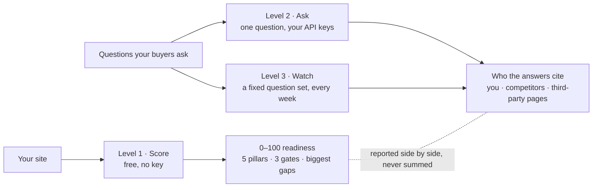
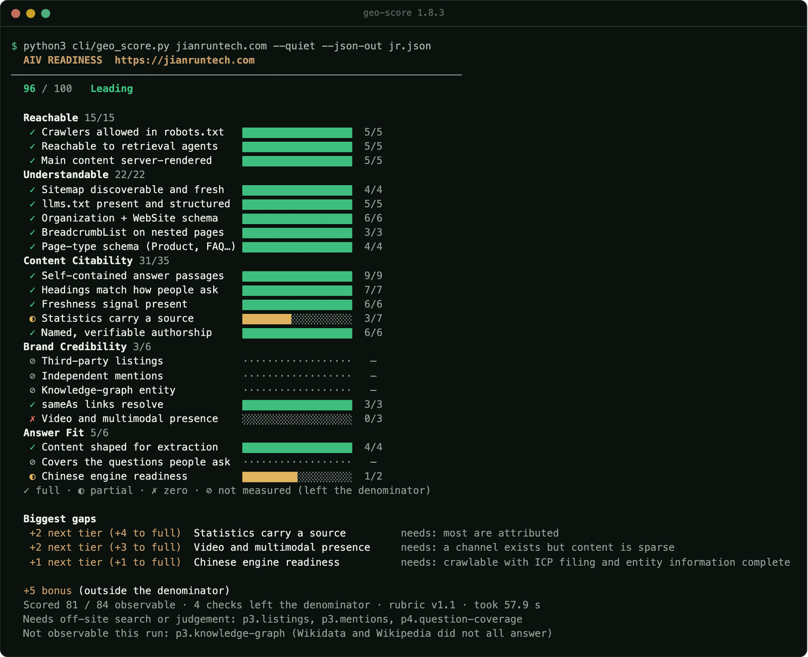
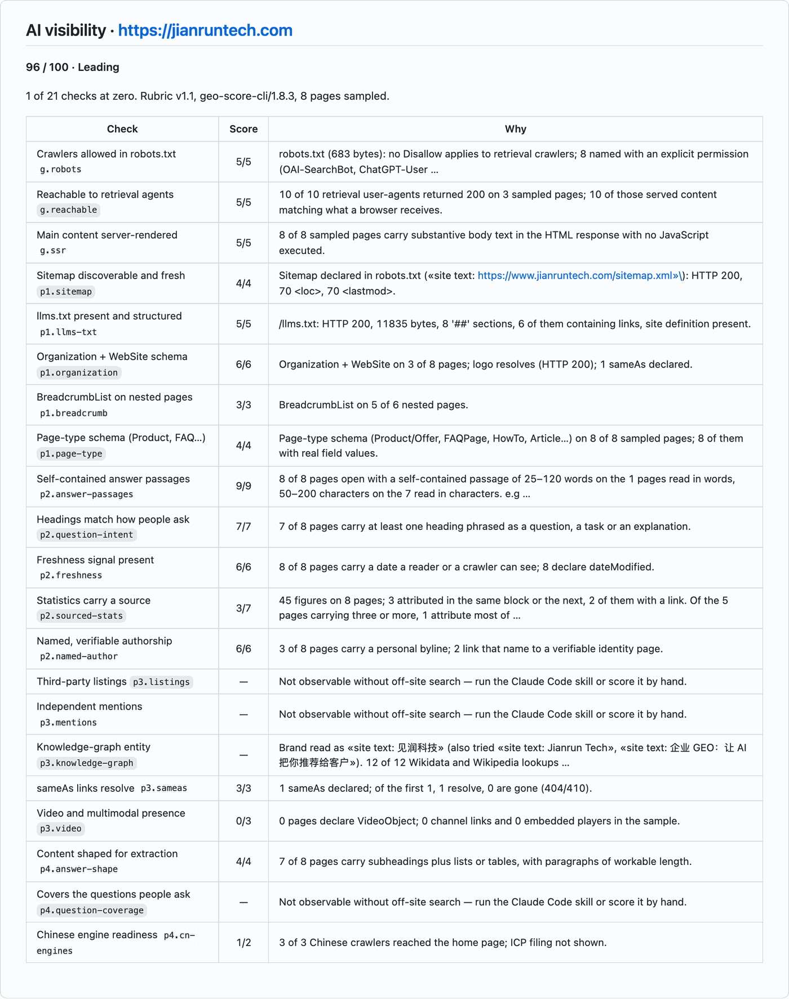
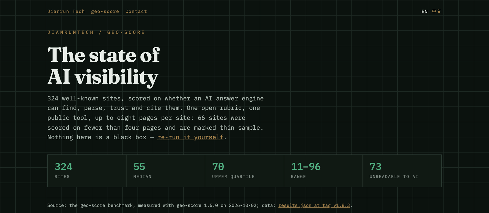
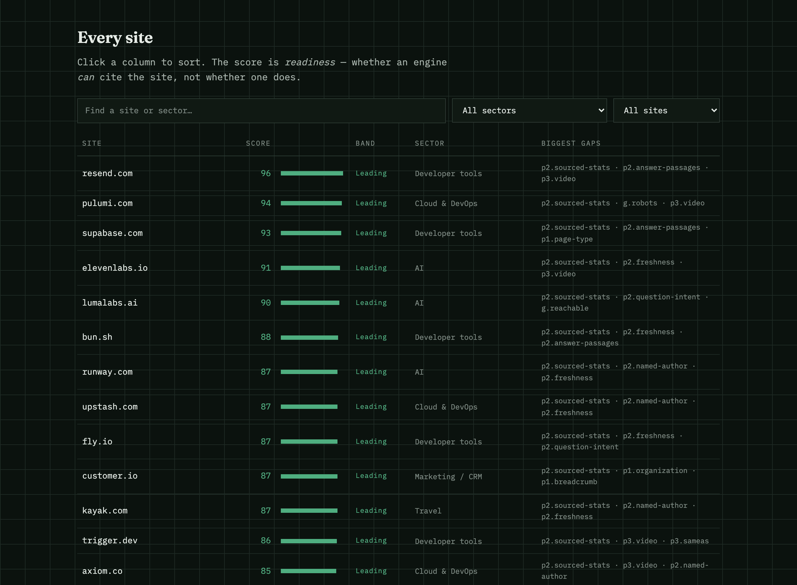

<p align="right"><a href="README.md">English</a> · <a href="README.zh-CN.md">简体中文</a></p>

<!-- mcp-name: io.github.jianruntech/geo-score -->

<p align="center"></p>

# geo-score

geo-score is an open-source AI visibility (GEO) scorer for websites, by [Jianrun Tech](https://www.jianruntech.com) (见润科技).
Formerly geo-watch: geo-watch merged into geo-score in 1.2.0 and lives on as its levels 2 and 3.
Website, docs and a free online check: [geo-score.dev](https://geo-score.dev).

## geo-score in 60 seconds

One command, a 0–100 score, the three gates, the gaps worth fixing first, and why every point can be re-checked.

https://github.com/user-attachments/assets/2270314f-446a-4c2d-b27f-11e1f6d66ff8

*English · 60 seconds · [Chinese version](README.zh-CN.md)*

---

> **Can AI engines cite your site? A free 0–100 score from one command. Do they? Check through their APIs with your own keys.**

geo-score scores a website from 0 to 100 on whether AI answer engines can reach it, parse it, trust it and cite it,
against a **published, versioned rubric** that anyone can recompute. Then, with your own API keys, it asks the engines
the questions your buyers ask and records whom the answers cite. The score is free and needs nothing installed; the
citation results are reported beside it and never added to it.

[Quick start](#quick-start) · [Screenshots](#screenshots) · [What it checks](#what-it-checks) ·
[How accurate is it?](#how-accurate-is-it) · [Docs](#documentation) · [Website](https://geo-score.dev) · [Changelog](CHANGELOG.md) ·
[Public leaderboard](https://www.jianruntech.com/leaderboard)

[](LICENSE)
[](rubric/v1.1.md)
[](cli/geo_score.py)
[](SKILL.md)
[](#mcp-server)
[](.github/CONTRIBUTING.md)
[](https://www.jianruntech.com/leaderboard)
[](https://pypi.org/project/geo-score/)
[](https://github.com/jianruntech/geo-score/releases/latest)

> **Version:** the current release is `geo-score==1.8.3` on [PyPI](https://pypi.org/project/geo-score/), with its tag,
> wheel and checksums on [GitHub Releases](https://github.com/jianruntech/geo-score/releases); what changed is in the
> [changelog](CHANGELOG.md). Every install line on this page is pinned to that release (`scripts/release.py --bump`
> moves them together), so the tool you run is the one these pages describe. The rubric is versioned separately, and
> v1.1 is current. main can run ahead of the release: for CI and client work, use the pinned release.

---

## ❤️ Sponsors

> [Want to appear here?](mailto:hello@jianruntech.com) · Sponsorship never affects the rubric, any score, the public
> leaderboard or the technical recommendations in these docs.

<details open>
<summary>Click to collapse</summary>

<table>
<tr>
<td width="180"><a href="https://www.ccsub.net/go/4V5TJGCN"></a></td>
<td>Thanks to CCSub for sponsoring this project! CCSub is an AI API relay platform: one API key for Claude, GPT, Gemini and DeepSeek models, compatible with Claude Code, Codex, Cursor and other coding tools. Register via <a href="https://www.ccsub.net/go/4V5TJGCN">this link</a>.</td>
</tr>
</table>

Sponsors have not been tested for geo-score's citation measurements (levels 2 and 3). Those need each engine's own
search-enabled API, and a relay may not pass web search and citations through unchanged.

</details>

## What problem it solves

> **GEO means Generative Engine Optimization** — getting cited by ChatGPT, Perplexity,
> Google AI Overviews, Gemini and Copilot. Nothing to do with geography or maps.

An answer engine quotes passages from sources it can reach, parse and trust. The reasons a site is left out are often
small and invisible from a browser: a `robots.txt` line that turns a retrieval crawler away, a page whose text only
exists after JavaScript runs, figures with no source. geo-score finds which of these a site has and what each one is
worth, then checks whether the engines cite it, in three levels:

> **Score** (free, no key) → **Ask** one question (your API keys) → **Watch** a question set every week (your API keys).

### Three levels, one tool

| Level | What it answers | Needs | Command |
|---|---|---|---|
| **1 · Score** | Can AI engines reach, parse, trust and cite the site? 0–100 against the open rubric | Nothing: no key, no install | `geo_score.py stripe.com` |
| **2 · Ask** | Right now, for a question you care about, do they cite it? | An API key for any of OpenAI, Perplexity, Gemini, Anthropic, OpenRouter | `geo_score.py stripe.com --ask "payments API for marketplaces"` |
| **3 · Watch** | How often are you cited, against which competitors and sources, week over week? | Your API keys and a fixed question list | `geo_score.py watch run` |



Level 1 is the score. Levels 2 and 3 measure the outcome the rubric keeps out of the score on
purpose ([two scores, never one](rubric/v1.1.md#two-scores-never-one)): they are reported next to
the 100 and never summed into it. A site can score 90 and still lose every answer to a competitor
with more third-party coverage, and the reverse also happens, which is why you want both.

### Why this is a different question from SEO

Classic SEO asks *where do I rank*. Answer engines don't rank — they retrieve passages,
decide whether a source is worth quoting, and cite it. Different question, different
failure modes: a site can sit at position 3 on Google and never be quoted. Because
engines retrieve passages, this rubric gives Content Citability the most weight. That is
a design choice, not a measured effect: the evidence for how much passage shape matters
is thin, and the [evidence table](rubric/evidence-v1.1.md#where-the-evidence-is-thinnest)
says where.

Most of what the rubric checks is **mechanical and cheap to fix** — a `robots.txt` line, a
JSON-LD block, a date in a template, a paragraph rewritten so it stands on its own. The
hard part is knowing which of them you are missing, and what each one is worth.

Two guides start here: [can ChatGPT read your website?](guide/chatgpt-access.md), a check you can do by hand and then
with geo-score, and [how geo-score differs from a general AI SEO skill](guide/vs-ai-seo-skills.md).

---

## Screenshots

Every image shows real output, captured for this page.

<table>
  <tr>
    <td width="50%" valign="top"><a href="assets/screens/cli-report.png"></a><br><sub><b>Level 1 in a terminal.</b> <code>geo_score.py jianruntech.com</code> (the maintainer's own site), run with geo-score 1.8.3 on 2026-10-17; the output with its colours, rendered to an image. Cut before the observations outside the score.</sub></td>
    <td width="50%" valign="top"><a href="assets/screens/action-summary.png"></a><br><sub><b>The GitHub Action's job summary</b> for the same report: the Markdown <code>action/summary.py</code> writes, rendered by GitHub's Markdown API. Cut after the check table.</sub></td>
  </tr>
  <tr>
    <td width="50%" valign="top"><a href="https://www.jianruntech.com/leaderboard"></a><br><sub><b>The public leaderboard</b>, captured 2026-10-17. Its figures come from the 2026-10-02 run with geo-score 1.5.0.</sub></td>
    <td width="50%" valign="top"><a href="https://www.jianruntech.com/leaderboard"></a><br><sub><b>Every site on the leaderboard</b>, sortable, with its band, sector and three biggest gaps by check id. Same page, same capture.</sub></td>
  </tr>
</table>

---

## Core capabilities

| Capability | What it does | More |
|---|---|---|
| **Score** (level 1) | 21 tiered checks in five pillars, three gates, the biggest gaps first, and what each next tier needs. One file, standard library only, no key | [What it checks](#what-it-checks) |
| **Ask** (level 2) | Puts one question to ChatGPT, Perplexity, Gemini and Claude through their search-enabled APIs, with your keys, and reports whom each answer cites | [Levels 2 and 3](#levels-2-and-3--does-ai-actually-cite-you) |
| **Watch** (level 3) | A fixed question set, week over week: cited rate with a 95% interval, share of voice, the sources the engines lean on, and a `diff` that calls a change a change only when a paired test says so | [Watch methodology](guide/watch-methodology.md) |
| **Reports and diffs** | Text, JSON against a published schema, SARIF and JUnit; `diff` compares two reports check by check, and `--baseline` re-scores the same pages | [CLI reference](cli/README.md) |
| **MCP server** | All three levels as tools for agents over stdio; `--read-only` gives a server that cannot spend | [MCP server](#mcp-server) · [guide/mcp.md](guide/mcp.md) |
| **GitHub Action** | Scores on every push, fails the build on a regression or a gate at zero, and writes a job summary | [GitHub Action](#github-action) · [action.yml](action.yml) |
| **Badge** | An optional SVG, or shields.io endpoint JSON, with your score and band. It never moves a score or a leaderboard place | [Badge](cli/README.md#a-badge-for-your-own-readme) |
| **Claude Code skill** | The CLI, plus the three checks that need off-site search or human judgement | [Claude Code skill](#claude-code-skill) · [SKILL.md](SKILL.md) |

---

## What it checks

21 tiered checks totalling 100 points, plus 4 bonus checks worth up to +6 outside the
denominator. Full specification: **[rubric/v1.1.md](rubric/v1.1.md)** · [简体中文](rubric/v1.1.zh-CN.md)

| Pillar | Pts | Asks |
|---|:-:|---|
| **Reachable** — *gates* | 15 | Can a retrieval crawler get the page at all? `robots.txt`, live reachability across 10 AI user-agents, server-rendered content |
| **Understandable** | 22 | Can it tell what the page and the company are? `Organization` + `WebSite`, `llms.txt`, sitemap, breadcrumbs, page-type schema |
| **Content Citability** | **35** | Is there anything here worth quoting? Self-contained answer passages, headings that match how people ask, sourced figures, real bylines, freshness |
| **Brand Credibility** | 18 | Why should an engine trust it? Knowledge-graph entity, third-party listings, `sameAs` that resolves, video presence |
| **Answer Fit** | 10 | Is the content shaped to be lifted into an answer? |

Content Citability carries the most weight by design: answer engines retrieve
**passages**, not domains. Whether passage shape outweighs domain authority is not
established: the heaviest single check, `p2.answer-passages`, rests on thin support
([where the evidence is thinnest](rubric/evidence-v1.1.md#where-the-evidence-is-thinnest)).

**Every scored check is tiered** — 2 to 4 tiers, each naming a count out of the 8 sampled
pages, so two people scoring the same site agree on the arithmetic. **Three checks are
gates**: score zero on crawler access, live reachability or server-rendered content and
the result caps at 40, because until a crawler can reach the content nothing else you
change has any effect.

### Bands

| 0–30 | 31–50 | 51–65 | 66–82 | 83–100 |
|:-:|:-:|:-:|:-:|:-:|
| Not started | Early | Growing | Solid | Leading |

Band names describe a **stage, not a verdict**. External benchmarks put most business
sites in the 30–55 range, so a score in the forties is ordinary, not alarming. In this repository's
own benchmark, 85% of 324 sites reach Early and 6% reach Leading
([where the cuts fall](benchmark/README.md#where-the-band-cuts-fall)).

---

## 324 sites, scored in public

**A quarter of them are unreadable to AI crawlers.** 73 sites have a gate check at zero — an
AI retrieval crawler cannot get the content, so it has nothing of theirs to quote. 20 block AI crawlers by name in
`robots.txt`, which is an editorial choice and reported as such — amazon.com lands at 17
for exactly this reason. **41 serve a page whose body only exists after JavaScript runs.**
Their content is there, a browser sees it, and a crawler gets an empty shell. That group
almost certainly did not choose it. At a further 12 the server refuses crawler user-agents (unverified
probes from the auditor's address).

Median **55** (95% CI 51–58, [stats.py](benchmark/stats.py)). Range 11 to 96. 66 sites were scored on
fewer than four pages; without them the median is 59.

| Site | Score | Band |
|---|:-:|---|
| resend.com | **96** | Leading |
| pulumi.com | **94** | Leading |
| supabase.com | **93** | Leading |
| elevenlabs.io | **91** | Leading |
| lumalabs.ai | **90** | Leading |
| … | | |
| qcloud.com | 12 | Not started |
| mercadolibre.com | 12 | Not started |
| keepa.com | 11 | Not started |

**[The full table, by sector →](https://www.jianruntech.com/leaderboard)** · [markdown](benchmark/README.md) · [raw data](benchmark/results.json) · [CSV](benchmark/results.csv) · [every site's full report](benchmark/raw/) · [re-run it](benchmark/run.py)

Two more findings worth the click. Sites in the five China sectors score **22 points
lower** than everyone else (95% CI 16–30; median 36 against 58; earlier samples measured with 1.1.0
put the gap between 16 and 23 points). Grouped by the language a site serves instead, the 54
Chinese-language sites score 26 points lower than the 270 others (95% CI 22–32), and within matched
sector families the gap runs from -8 to 27 points. Counted check by check in raw points, 69% of the gap
sits in checks the CLI reads with a heuristic, so at most that share could be the tool misreading
Chinese pages ([the breakdown](benchmark/README.md#what-the-spread-shows)). The two largest per-check
differences, question-shaped headings and self-contained answer passages, are heuristics the CLI also
read lower than a human on the one Chinese site in the [hand-audit comparison](benchmark/VALIDITY.md),
so part of the gap may be the tool reading Chinese pages conservatively. From 1.5.0 the CLI reads each
page in its own language and counts Chinese task, explanation and comparison headings; the leaderboard
above was measured with 1.5.0, so its figures include that change. And statistics that carry a source
and a named, verifiable byline are among the three largest gaps on more than half the sites.

Every number here is reproducible with the command in [Quick start](#quick-start) (the benchmark
was run with 1.5.0 on 2026-10-02) — and we measured how reproducible. On 2026-10-12, 1.8.0 scored
the whole list three times from one place the same day (the third run re-reading the first run's pages):
of the 317 sites scored every time, **99% landed within ±5 between the first two runs and 81% scored
identically** (ICC 0.99, SEM 1.9; [REPRODUCIBILITY.md](benchmark/REPRODUCIBILITY.md), derived by
[benchmark/retest.py](benchmark/retest.py)). An older 1.1.x build, measured on 2026-09-09, put 96% within ±5
and 45% identical. Read one site's score as ±5 rather than as exact; medians are stable. Most of what still
moves is the knowledge-graph lookup, which went unanswered on most sites from that vantage, and the gate
checks of sites whose bot protection answers a crawler differently from one run to the next.
The band, the control experiment and the per-site pairs are in
[benchmark/REPRODUCIBILITY.md](benchmark/REPRODUCIBILITY.md).

For five reference sites we also publish **hand-scored audits** covering all 21 checks,
with the evidence behind each one: [examples/audits/v1.1/](examples/audits/v1.1/).

---

## How accurate is it?

Five questions people ask, and where this repository answers each one:

| Question | Answer | Record |
|---|---|---|
| Score the same site twice: how far apart? | A same-day retest with 1.8.0 on 2026-10-12: 99% of 317 sites within ±5 and 81% identical (ICC 0.99) | [REPRODUCIBILITY.md](benchmark/REPRODUCIBILITY.md) |
| Can anyone recompute it? | Yes: every check, tier and weight is published, so the same pages give the same score whoever runs it | [rubric/v1.1.md](rubric/v1.1.md) |
| Does it match a person reading the same rubric? | 80% of 84 check pairs land in the same tier; only 5 sites, all of them calibration sites | [VALIDITY.md](benchmark/VALIDITY.md) |
| Do the weights decide the ranking? | With equal weights, or 300 random perturbations of them, the rank correlation stays at 0.99 or above | [SENSITIVITY.md](benchmark/SENSITIVITY.md) |
| Are higher-scoring sites cited more often by AI? | The preregistered test's first wave (2026-10-12 to 14; 16 categories, 83 sites, 1,280 answers from one engine): no association was detected (T = 0.07, p = 0.51); the design could detect a T at least as large as 0.29. Not detected is not the same as none | [RESULTS-wave0.md](benchmark/prereg/round0/RESULTS-wave0.md), [PREREGISTRATION.md](benchmark/PREREGISTRATION.md) |

**Against hand audits.** The CLI leaves the three checks that need off-site search or human judgement
out of the denominator rather than guessing (and a fourth,
`p4.cn-engines`, unless the site serves Chinese). Re-scoring
the five published hand audits on the same pages, it matched the auditor's tier on 80% of
84 check pairs (92% where it reads a rule, 69% where it approximates a judgement). On the checks
both scored it read 2.4 points lower on average (per site from 12 lower to 10 higher; mean absolute
difference 8.8). Its full normalised score read 5.2 points lower on average, from 16 lower to 7
higher, because the hand audits also score `p3.listings`, `p3.mentions` and `p4.question-coverage`,
which the CLI leaves out. n=5, all of them calibration sites:
[VALIDITY.md](benchmark/VALIDITY.md) lists every disagreement.

---

<a id="ways-to-run-it"></a>

## Quick start

### One command

Python 3.8+, standard library only, nothing to install. It reads public URLs and prints
a score against a **published, versioned rubric** — not a black box.

```bash
curl -sL https://raw.githubusercontent.com/jianruntech/geo-score/v1.8.3/cli/geo_score.py \
  | python3 - stripe.com --brief
```

<details>
<summary>Full output — every check, and what the next tier asks for (<code>--explain</code> adds the evidence)</summary>

```
  AIV READINESS  https://stripe.com
──────────────────────────────────────────────────────────────────────────
  72 / 100   Solid
  11 points to Leading

  Reachable 13/15
   ◐ Crawlers allowed in robots.txt   ███████████░░░░░░░  3/5
   ✓ Reachable to retrieval agents    ██████████████████  5/5
   ✓ Main content server-rendered     ██████████████████  5/5
  Understandable 17/22
   ◐ Sitemap discoverable and fresh   █████████░░░░░░░░░  2/4
   ✓ llms.txt present and structured  ██████████████████  5/5
   ✓ Organization + WebSite schema    ██████████████████  6/6
   ✗ BreadcrumbList on nested pages   ░░░░░░░░░░░░░░░░░░  0/3
   ✓ Page-type schema (Product, FAQ…) ██████████████████  4/4
  Content Citability 21/35
   ✓ Self-contained answer passages   ██████████████████  9/9
   ◐ Headings match how people ask    ████████░░░░░░░░░░  3/7
   ◐ Freshness signal present         █████████░░░░░░░░░  3/6
   ◐ Statistics carry a source        ████████░░░░░░░░░░  3/7
   ◐ Named, verifiable authorship     █████████░░░░░░░░░  3/6
  Brand Credibility 9/10
   ⊘ Third-party listings             ··················   —
   ⊘ Independent mentions             ··················   —
   ✓ Knowledge-graph entity           ██████████████████  4/4
   ✓ sameAs links resolve             ██████████████████  3/3
   ◐ Video and multimodal presence    ████████████░░░░░░  2/3
  Answer Fit 2/4
   ◐ Content shaped for extraction    █████████░░░░░░░░░  2/4
   ⊘ Covers the questions people ask  ··················   —
   ⊘ Chinese engine readiness         ··················   —
  ✓ full · ◐ partial · ✗ zero · ⊘ not measured (left the denominator)

  Biggest gaps
   +3 next tier (+3 to full)  Freshness signal present          needs: most pages do, and dateModified agrees with the visible date
   +3 next tier (+3 to full)  Named, verifiable authorship      needs: and the name links to a verifiable identity page
   +2 next tier (+2 to full)  Crawlers allowed in robots.txt    needs: mainstream retrieval user-agents explicitly allowed

  Scored 62 / 86 observable · 4 checks left the denominator · rubric v1.1 · took 91.5 s
  Needs off-site search or judgement: p3.listings, p3.mentions, p4.question-coverage
  Not observable this run: p4.cn-engines (not a Chinese-language site)

  Full rubric and what each tier means:
  https://github.com/jianruntech/geo-score/blob/v1.5.0/rubric/v1.1.md
  Score moved, or a check shows —? https://github.com/jianruntech/geo-score/blob/v1.5.0/guide/troubleshooting.md
```

<sub>`geo_score.py stripe.com`, recorded with geo-score 1.5.0 on 2026-10-03 through an HTTPS proxy (the footer's time includes it). For a run with 1.8.3, see [Screenshots](#screenshots). From 1.7.0 the report also prints three observations under **Outside the score** after the checks (robots.txt rules page by page, links in the server HTML, hreflang), which never move the score; this recording predates them. See [cli/README.md](cli/README.md#outside-the-score).</sub>

</details>

### From PyPI: uvx or pipx

All three levels. Levels 2 and 3 need `cli/geo_watch.py` next to `cli/geo_score.py`, and the package on PyPI has
both; a clone, or both files downloaded, works too. Neither line below needs git or a build step.

```bash
uvx geo-score@1.8.3 example.com            # run it without installing (needs uv)
pipx install geo-score==1.8.3              # or install the geo-score command
geo-score example.com --explain            # every check, with the evidence behind it
```

Without access to PyPI, install the same wheel from the release:
`pipx install https://github.com/jianruntech/geo-score/releases/download/v1.8.3/geo_score-1.8.3-py3-none-any.whl`.
From source (needs git): `pipx install git+https://github.com/jianruntech/geo-score@v1.8.3`.
Standard library only, whichever you pick. Release downloads carry a `SHA256SUMS` file, and the wheel and
sdist on PyPI match it byte for byte ([how to check](.github/SECURITY.md#verifying-a-download)).

<details>
<summary>Every way to call the CLI, and an optional badge for your own README</summary>

**CLI** — level 1 is one file with no dependencies, and every report records how long its run took
(`elapsed_s`). Levels 2 and 3 add `cli/geo_watch.py` from the same release. With the package from PyPI,
`uvx geo-score@1.8.3` (or `geo-score`, after `pipx install geo-score==1.8.3`) takes the place of
`python3 cli/geo_score.py` below, all three levels included.

```bash
python3 cli/geo_score.py example.com            # human-readable
python3 cli/geo_score.py example.com --explain  # with the evidence behind every check
python3 cli/geo_score.py example.com --json     # conforms to schema/report.v2.json
python3 cli/geo_score.py example.com --compare competitor.com   # side by side
python3 cli/geo_score.py example.com --badge aiv-badge.svg      # embeddable SVG
python3 cli/geo_score.py example.com --badge-json aiv-badge.json  # the same badge as shields.io endpoint JSON
python3 cli/geo_score.py example.com --share                    # one line to paste somewhere
python3 cli/geo_score.py diff before.json after.json             # what changed between two reports, check by check
python3 cli/geo_score.py example.com --baseline before.json --fail-on-drop   # CI: re-score the same pages, fail only on a drop
```

**"Scored with geo-score": an optional badge for your own README.** `--badge aiv-badge.svg` writes an SVG with your
score and band. Commit it next to your README and link it to what the number means, this repository or
[the public leaderboard](https://www.jianruntech.com/leaderboard):

```markdown
[](https://github.com/jianruntech/geo-score)
```

It is optional, and it changes nothing: a badge or a link back never moves a score, and never decides whether or
where a site appears on the leaderboard. A site joins the leaderboard through the
[Add a site](.github/CONTRIBUTING.md#the-easiest-useful-contribution) route, never in exchange for a link. A committed
SVG shows the run that wrote it; `--badge-json` writes the same badge as shields.io endpoint JSON, so it can stay
current without a new image ([details](cli/README.md#a-badge-for-your-own-readme)).

</details>

### Claude Code skill

The CLI measures what a static fetch can see. Three checks need
off-site search or human judgement, and the skill does those too.

```bash
npx skills add jianruntech/geo-score     # add -g for a global install
# then: /geo-score audit https://example.com
```

`npx skills add` runs the open [skills CLI](https://github.com/vercel-labs/skills). It finds one skill in this
repository, `geo-score`, and copies the whole repository (about 9 MB) as it is on the default branch, main,
into `.claude/skills/geo-score` for Claude Code. Without Node.js, or for the release rather than main, clone the
release tag into your own skills folder instead:
`git clone --branch v1.8.3 --depth 1 https://github.com/jianruntech/geo-score ~/.claude/skills/geo-score`.

How close the CLI comes without the skill: [How accurate is it?](#how-accurate-is-it)

### MCP server

`geo-score-mcp` is a local MCP server (stdio, Python standard library only). It gives an agent the
same three levels as the CLI: score a site for free, ask the AI engines one question, and track a
question set week over week. `uvx geo-score@1.8.3 mcp` runs it from PyPI (`geo-score-mcp` after a pipx install), and
`python3 cli/geo_score.py mcp` runs it from a clone.

<!-- BEGIN MCP:install -->
<!-- Generated by scripts/mcp_docs.py for version 1.8.3; edit the script, not this block. -->

[](https://cursor.com/en/install-mcp?name=geo-score&config=eyJjb21tYW5kIjoidXZ4IiwiYXJncyI6WyJnZW8tc2NvcmVAMS44LjMiLCJtY3AiXX0%3D)
[](https://insiders.vscode.dev/redirect?url=vscode%3Amcp%2Finstall%3F%257B%2522name%2522%253A%2522geo-score%2522%252C%2522command%2522%253A%2522uvx%2522%252C%2522args%2522%253A%255B%2522geo-score%25401.8.3%2522%252C%2522mcp%2522%255D%257D)
[](https://insiders.vscode.dev/redirect?url=vscode-insiders%3Amcp%2Finstall%3F%257B%2522name%2522%253A%2522geo-score%2522%252C%2522command%2522%253A%2522uvx%2522%252C%2522args%2522%253A%255B%2522geo-score%25401.8.3%2522%252C%2522mcp%2522%255D%257D)
[](https://lmstudio.ai/install-mcp?name=geo-score&config=eyJjb21tYW5kIjoidXZ4IiwiYXJncyI6WyJnZW8tc2NvcmVAMS44LjMiLCJtY3AiXX0%3D)

The buttons and the lines below run geo-score **1.8.3** from PyPI with `uvx`, which needs only [uv](https://docs.astral.sh/uv/): no git and no build step. They add no keys of their own, but a server started from a shell that exports a provider key (Claude Code passes its environment on) can use it. For a server that cannot spend, add `--read-only` after `mcp`.

**Claude Code**

```bash
claude mcp add --scope user geo-score -- uvx geo-score@1.8.3 mcp
```

**Standard config** (no keys in the file) for any client that reads an `mcpServers` file:

```
{
  "mcpServers": {
    "geo-score": {
      "command": "uvx",
      "args": ["geo-score@1.8.3", "mcp"]
    }
  }
}
```

Claude Desktop does not read your shell's `PATH`: put the full path that `which uvx` prints in `command`.

Without access to PyPI, the release wheel: `uvx --from https://github.com/jianruntech/geo-score/releases/download/v1.8.3/geo_score-1.8.3-py3-none-any.whl geo-score-mcp`

From source (needs git): `uvx --from git+https://github.com/jianruntech/geo-score@v1.8.3 geo-score-mcp`
<!-- END MCP:install -->

<details>
<summary>The tools, what each one costs, and the keys and config they read</summary>

<!-- BEGIN MCP:tools -->
<!-- Generated by scripts/mcp_docs.py from MCPServer.tools(); edit the server or the script, not this table. -->

| Tool | Level | Cost | Writes | Hints | Args |
|---|:-:|---|---|---|---|
| `score_site` | 1 | Free | No | read-only, open-world | **`url`**, `urls`, `sample` |
| `ask` | 2 | Paid (your keys) | No | non-destructive, open-world | **`question`**, `engines`, `brand`, `domains` |
| `run` | 3 | Paid (your keys); `dry_run` is free | A run file under `.geo-score/watch/runs/`, next to the config | non-destructive, open-world | `dry_run`, `engines`, `limit`, `max_calls`, `budget_usd` |
| `list_runs` | 3 | Free | No | read-only, idempotent | — |
| `report` | 3 | Free | No | read-only, idempotent | `run`, `since`, `format` |
| `diff` | 3 | Free | No | read-only, idempotent | `from`, `to`, `format` |
| `status` | — | Free | No | read-only, idempotent | — |

Resources: `geo-score://rubric/v1.1`.

Prompts: `audit_site` (**`url`**), `check_citations` (**`question`**, `brand`), `weekly_watch`, `compare_runs` (`from`, `to`), `explain_check` (**`check_id`**).

Bold arguments are required. Hints are the tools' MCP annotations: clients may use them to decide what to confirm, and they are hints, not guarantees. **Only `ask` and `run` can spend money**, and only with the provider keys you give the server.
<!-- END MCP:tools -->

**Things to ask your agent:**

| Prompt | What it calls |
|---|---|
| Score https://acme.com for AI-search readiness and list the 3 checks with the most points to gain. | `score_site` with `url` |
| Dry-run my tracked questions and tell me the planned calls and caps. | `run` with `dry_run: true` (level 3, needs a config) |
| Compare my last two watch runs: which engines changed, and is any change outside the noise? | `diff` (defaults to the latest two runs) |

**Keys and config.** `score_site` needs no key. `ask` and `run` read the provider keys
(`OPENAI_API_KEY`, `PERPLEXITY_API_KEY`, `GEMINI_API_KEY`, `ANTHROPIC_API_KEY`, `OPENROUTER_API_KEY`)
from the server's environment, which is not your terminal's: a desktop app does not see what you
exported in a shell. The level 3 tools also need a `geo-score-watch.json`. Pass it as
`-c /absolute/path/geo-score-watch.json`, because a GUI client does not start the server in your
project. From 1.4.0, `--read-only` gives a server that cannot spend anything.

</details>

Setup for each client (Claude Code, Claude Desktop, Codex, Cursor, VS Code, Gemini CLI, Devin
Desktop, Zed), the Claude Code plugin, timeouts, security and troubleshooting:
**[guide/mcp.md](guide/mcp.md)**.

### GitHub Action

Level 1 on every push: score the site, and fail the build when it regresses. For level 3 on a
schedule, see [examples/ci/watch-weekly.yml](examples/ci/watch-weekly.yml).

```yaml
- uses: jianruntech/geo-score@v1
  with:
    url: https://example.com
    fail-under: 40
    fail-on-gate: true
```

A gate at zero caps the score at 40: a site that would otherwise score 40 or more reads exactly 40 and passes `fail-under: 40`. `fail-on-gate: true` fails any capped site.

The job summary it writes is in [Screenshots](#screenshots).

---

## Levels 2 and 3 · does AI actually cite you?

`--ask` and `watch` put the questions your buyers ask to ChatGPT, Perplexity, Gemini and Claude,
through each provider's search-enabled API with your own keys, and record who the answers cite:
you, your competitors, or the third-party pages (forums, review sites) the engines lean on
instead. Keys are read from the environment; geo-score never writes them anywhere.

```bash
git clone --branch v1.8.3 --depth 1 https://github.com/jianruntech/geo-score && cd geo-score/cli
export OPENAI_API_KEY=… PERPLEXITY_API_KEY=…         # any subset of engines works
python3 geo_score.py acme.com --ask "invoicing app for freelancers"        # level 2
python3 geo_score.py watch init --brand Acme --domain acme.com --competitor "Rival=rival.com"
# put the questions your buyers ask an AI assistant into queries.csv, then:
python3 geo_score.py watch run --dry-run            # the plan, the caps, what a diff could detect and how precise one question's rate is; no calls, no cost
python3 geo_score.py watch run                      # level 3: every question on every engine, saved
python3 geo_score.py watch diff                     # this run against the last, with a significance test
python3 geo_score.py watch report --since 30        # the last 30 days pooled, one interval over questions
```

**Level 2** asks each engine each question once and prints the result under the readiness
report (and into the report's `citation` object with `--json`). One ask is an anecdote: use it to
see what the engines say today, not to measure a rate.

<details>
<summary>What a watch run prints (illustrative: made-up brands and canned answers, not a real measurement; a run saved by 1.2.0, printed by 1.8.0)</summary>

```
geo-score watch · Lumo · run 20260926T083000Z · api channel

6 questions × 2 engines × 2 = 24 planned · 23 answered · 1 failed · 0 skipped

Cited in 38% of answers to questions that do not name Lumo (6 of 16, 4 questions, 95% CI 12–62%) · mentioned in 38%
Questions that name Lumo (2, kept out of the headline): cited in 100% (7 of 7, 95% CI 65–100%) · mentioned in 100%
Your site was cited somewhere for 5 of 6 questions.

By engine
  engine          model             cited         95% CI   mentioned  named first (tracked)  avg rank
  chatgpt-api     gpt-6-luna        9/12 75%      42–100%  75%        9/12                   1.0
  perplexity-api  sonar             4/11 36%      8–75%    36%        0/11                   2.0       1 failed
  gemini-api      gemini-3.8-flash  not measured                                                       no_key: set GEMINI_API_KEY or GOOGLE_API_KEY

These rows, and the tables below, count every question, the 2 that name Lumo included.

Answer share your pages support: not measured; this run was saved before citation positions were recorded.

Sources listed and used in the answer: not measured; this run was saved before listed sources were recorded.

Repeat consistency of cited domains (per engine; descriptive, not read by diff)
  engine          questions measured  pairs  median Jaccard
  chatgpt-api     6/6                 6      1.00
  perplexity-api  5/6                 5      1.00
  gemini-api      not measured                               no_key

Least consistent questions (up to 3 per engine):
  id   question                         engine          answers that cite  Jaccard
  q02  ai video tool with no watermark  chatgpt-api     2                  0.50
  q01  best free ai video generator     perplexity-api  2                  0.50

- Repeat consistency: for each question an engine answered more than once in this run, the overlap of the domains two of its answers cite, shared domains over all domains of the two (Jaccard), for every two answers, averaged per question; the median over questions per engine. 1: every ask cited the same domains; 0: no domain in common. Domains are read as everywhere in this report, www dropped; the order of citations is not compared.
- Answers that cite nothing are left out: two empty lists are not agreement, and one empty list is not a 0. On an engine, a question with fewer than two answers that cite is not measured. Lowest: up to 3 questions per engine whose answers did not all cite the same domains, lowest first.
- Descriptive only: no interval and no test, never part of the cited rate, and watch diff does not read it. It describes asks minutes apart in one run, which share that day's index; it is not computed over pooled runs.

Share of voice
              cited  95% CI  mentioned  named first (tracked)  sentence share
  Lumo (you)  57%    26–86%  57%        9/23                   100%
  Pixa        52%    33–71%  100%       14/23                  100%

- Named first (tracked): answers that name that brand before any other brand in your config, out of the answers that name at least one of them. Brands your config does not list are not seen, so first among the brands you track may not be first in the answer. Two brands first named at the same place, one name inside the other, are neither first.
- Sentence share: in the answers that name a brand, the mean share of their sentences that name it, every sentence counted the same. A sentence ends at a line break, at 。！？, or at . ! ? before a space.
- Both read the answer as saved, which keeps its first 20,000 characters; a name that first appears after that is not seen.

Sources the engines cite most (not yours)
  domain        answers  share  owner
  pixa.example  12       52%    Pixa
  reddit.com    11       48%

Questions where a competitor is cited and you are not (1)
  id   question                    cited instead
  q03  cheapest text to video app  Pixa

Who is named for each question
  id   question                         answers  Lumo (you)             Pixa               no tracked brand named  searched yes/no/unknown  most cited
  q01  best free ai video generator     4        cited 3/4 · named 3/4  cited 2 · named 4  0/4                     2/0/2                    Lumo (you)
  q02  ai video tool with no watermark  4        cited 1/4 · named 1/4  cited 2 · named 4  0/4                     2/0/2                    Pixa
  q03  cheapest text to video app       4        cited 0/4 · named 0/4  cited 2 · named 4  0/4                     2/0/2                    Pixa
  q04  lumo vs pixa                     4        cited 4/4 · named 4/4  cited 2 · named 4  0/4                     2/0/2                    Lumo (you)
  q05  pixa alternatives                4        cited 2/4 · named 2/4  cited 2 · named 4  0/4                     2/0/2                    —
  q06  鹿末视频免费吗                   3        cited 3/3 · named 3/3  cited 2 · named 3  0/3                     2/0/1                    —

- An answer given without a web search cannot cite anything.
- "No tracked brand named" counts answers that name none of the brands in your config; they may name others.
- Perplexity and OpenRouter search on every call or do not say, so their answers count as unknown under searched.

By question type
  type         cited     95% CI   mentioned
  alternative  2/4 50%   15–85%   50%
  list         4/8 50%   22–78%   50%
  pricing      3/7 43%   0–100%   43%
  vs           4/4 100%  51–100%  100%

What the engines searched for (from 12 answers that show it)
  times  search
  2      best free ai video generator
  2      ai video tool with no watermark
  2      cheapest text to video app
  2      lumo vs pixa
  2      pixa alternatives
  2      鹿末视频免费吗

- Of 12 searches: 0 contain a year, 6 contain a ranking or comparison word.

Ledger
24 questions asked · 23 API requests · 14,620 in / 4,860 out tokens · 23 searches · $0.07 + 12 answers with no price (add prices to geo-score-watch.json)
1 failed after 24 HTTP requests in all; a request that timed out may still be billed.
Caps: at most 100 questions.

Read this before quoting the numbers
- API channel. Answers come from each provider's search-enabled API, which is not the consumer app. Compare runs with runs; never pool them with answers sampled by hand in the apps.
- The same question gets different answers from one ask to the next, and answers to one question move together. Rates carry a 95% interval: Wilson when each question was answered once, a bootstrap over questions when a question has several answers. diff pairs the questions both runs answered and calls a change a change only when an exact paired test (McNemar, or a sign-flip test when a question has several answers), Holm-corrected across engines, says so (p < 0.05).
- A question that names the brand invites an answer that cites it. Those questions are kept out of the headline rate and reported on a line of their own.
- Engines without a key, calls that failed and calls skipped by a cap count as not measured, never as zero.
- This measures citations. It does not predict traffic, rankings or revenue.
- This run was saved before questions were flagged at run time. Questions that name the brand were found when this report was made, from the saved question text and the run's brand name, aliases and domains.
```
</details>

<details>
<summary>What level 3 reports, what it will not tell you, the engines, and caps and cost</summary>

**Level 3** keeps a fixed question list, saves every answer under `.geo-score/watch/runs/`
([schema](schema/watch.v1.json)), and reports:

| | Meaning |
|---|---|
| **cited** | The answer links to a URL you own: one of your `domains` (subdomains included), or a `url_prefixes` entry such as your Amazon store or GitHub org |
| **rank** | Your position among the distinct domains the answer cites. Rank 1 means you were the first source |
| **mentioned** | The answer names you, one of your `aliases` or your domain. Chinese, Japanese and Korean names match anywhere; all other names match whole words only |
| **share of voice** | The same two rates for each competitor, over the same answers |
| **sources** | The third-party domains cited most often: the pages the engines trust in your category |
| **answer share** | How much of each answer your pages support (`supported_share`): by characters, by sentences and by position-weighted characters, read from where the provider says each citation sits. Printed beside the cited rate, never merged into it; an answer whose citations carry no position is not measured |
| **sources listed and used** | Perplexity and Gemini (`generate_content`) return sources beside the answer and mark the ones the text uses: sources listed and used per answer, used over listed, and the answers that list and use a URL of yours. APIs that return one list are not measured |
| **repeat consistency** | When a run asks a question more than once on an engine: how far the cited domains agree between asks (Jaccard, the median over questions per engine), and the least consistent questions. Descriptive only; `watch diff` does not read it |
| **gaps** | Questions where a competitor is cited and you are not, in any answer |
| **searches** | The searches the engine actually ran before answering, where the API exposes them (OpenAI, Gemini, Claude). This is the query fan-out, observed rather than guessed. The report counts how many contain a year or a ranking or comparison word, and says so when answers searched but the endpoint returned no query text |
| **ledger** | Questions asked, API requests, tokens, searches and cost. Every run keeps its own ledger |

**What it will not tell you.**

- **It is not the ChatGPT app.** Answers come from each provider's API with web search switched
  on. The consumer apps use other models, prompts and personalisation. Compare API runs with API
  runs; never pool them with answers sampled by hand in the apps.
- **Some surfaces are out of reach.** Google AI Overviews and AI Mode, the AI summaries inside apps such
  as TikTok, Reddit or Xiaohongshu, an assistant's memory and account settings, location finer than the
  country hint, and which library a coding agent picks cannot be reached through these APIs.
- **A citation is presence, not merit.** A citation rate says an engine named and linked you, not that what
  it said is true or that the page deserved it; engines also cite misleading and self-promotional pages.
- **One answer is an anecdote.** Every rate carries a 95% interval (a bootstrap over questions
  when a question has several answers, since those answers move together), and `diff` calls
  something a change only when an exact paired test on the questions both runs answered,
  Holm-corrected across engines, says so (p < 0.05). Too few shared questions (under 6, or too few
  for the number of engines compared) is reported as too few to tell. The method: [guide/watch-methodology.md](guide/watch-methodology.md).
- **Questions that name you are kept apart.** "acme vs rival" or "is acme worth it" put your name
  in the engine's search and are cited almost every time. `watch` flags them when it runs, keeps
  them out of the headline rate, and reports them on their own line with their own count. An
  optional `branded` column in `queries.csv` corrects the flag by hand.
- **Not measured is not zero.** An engine without a key, a failed call and a capped call are all
  reported as not measured, and none of them lowers your rate.
- **Citations are not traffic.** Nothing here predicts visits, rankings or revenue.

**Engines.** Pin the model you mean in the config and keep it fixed between runs; `diff` flags a
run where the model changed. OpenRouter covers hundreds of models with one key.

| Engine id (default) | Provider | Key | Default model | What counts as cited | Searches shown | Cost reported |
|---|---|---|---|---|---|---|
| `chatgpt-api` | OpenAI Responses API + `web_search` | `OPENAI_API_KEY` | `gpt-6-luna` | `url_citation` annotations | yes | no, set prices |
| `perplexity-api` | Perplexity Sonar | `PERPLEXITY_API_KEY` | `sonar` | numbered sources the answer uses | no | yes |
| `gemini-api` | Gemini Interactions API + `google_search` | `GEMINI_API_KEY` or `GOOGLE_API_KEY` | `gemini-3.8-flash` | `url_citation` annotations | yes | no, set prices |
| `claude-api` | Anthropic Messages + `web_search` tool | `ANTHROPIC_API_KEY` | `claude-sonnet-5` | citations on the answer text | yes | no, set prices |
| any id you choose | OpenRouter + `web` plugin (the model answering over OpenRouter's search, not the vendor's own) | `OPENROUTER_API_KEY` | `openai/gpt-6-luna` | `url_citation` annotations | no | yes |

**Caps and cost.** `max_calls` is an exact cap on questions asked in a run, and a plan that
exceeds it refuses to start. `budget_usd` is checked before every call against the spend so far
plus the most expensive call seen on that engine, so it can be exceeded by at most one call per
engine; with a budget set, engines whose cost cannot be known are left out unless you pass
`--allow-unpriced`. Every run keeps a ledger of requests, tokens, searches
and cost. Configuration, prices and all commands: [cli/README.md](cli/README.md#watch).

**From an agent.** Levels 2 and 3 are also MCP tools, and an agent can only tighten your caps,
never loosen them: see [MCP server](#mcp-server).

**Every week.** Citation rates move slowly and noisily: run on the same weekday with the same
questions and models, and read `diff`, not single runs.
[examples/ci/watch-weekly.yml](examples/ci/watch-weekly.yml) does it on a schedule with keys from
repository secrets and commits each run, so the history lives in git. Run files contain your
questions and the full answers: use a private repository if they are confidential.

</details>

**Run it yourself, or have it run for you.** Everything here is MIT; the tool has no paid edition.
You pay your model providers directly and the ledger shows what each run used. What needs people
rather than an API, [Jianrun](https://www.jianruntech.com/en/) does as a service:

| | Run it yourself (free) | Run by Jianrun |
|---|---|---|
| Channel | Provider APIs with search | APIs and the consumer apps, sampled by hand each week |
| Engines | OpenAI, Perplexity, Gemini, Anthropic, anything on OpenRouter | ChatGPT with search, Perplexity, Gemini, Google AI Overviews, Copilot; Chinese engines when you sell into China |
| Report | Text, Markdown, CSV, JSON | A weekly report with the AIV dashboard: citation trend, per-engine rates, facts AI gets wrong about you, readiness history |
| When citations drop | Out of scope | We do the fixing |
| Price | Your API bill | AEO delivery system, from US$7,790 per quarter (US$30,590 paid yearly), AIV dashboard included. [See pricing](https://www.jianruntech.com/en/#pricing) |

---

## Who it is for

| Who | What they use it for | Where to start |
|---|---|---|
| **Site owners and marketing teams** | Whether AI engines can reach and quote the site, and which gaps are worth the most points | `--brief`, then `--explain`; level 2 for the questions that matter to you |
| **Agencies and consultants** | A diagnosis the client can re-check against a published, versioned rubric; the same pages re-scored after each change | `--json`, `--baseline last.json`, `diff`; name the rubric version in the report |
| **Developers and CI** | A failed build when a deploy blocks crawlers, drops server rendering or loses points | The [GitHub Action](#github-action), `--fail-on-gate`, `--assert`, SARIF and JUnit |
| **Researchers** | Every published number recomputed, the weights challenged, readiness tested against citations | [rubric/v1.1.json](rubric/v1.1.json), [benchmark/](benchmark/), the [preregistration](benchmark/PREREGISTRATION.md) |

geo-score measures whether engines **can** cite a site and whether they **do**. It does not fix anything, and it never
predicts traffic, rankings or revenue.

---

## Boundaries and governance

| Area | Where it stands |
|---|---|
| Measurement, not remediation | No fix templates, rewriting or per-engine tactics, beyond two public-knowledge examples: [Scope](#scope--what-this-does-not-do) |
| Rubric changes | Public proposals, a comment period and an independent review; no certification sold: [rubric governance](rubric/governance.md) |
| Weights | Each check declares what its weight rests on, with sources and the date they were checked: [evidence table](rubric/evidence-v1.1.md) |
| Privacy | No telemetry. Level 1 fetches the site, what its markup and robots.txt point to, and Wikidata and Wikipedia search; levels 2 and 3 call only the providers whose keys you set |
| Stability | The report schema, check ids, CLI flags, exit codes, Action inputs and MCP tools are public contracts: [stability policy](guide/stability.md) |

### Scope — what this does *not* do

This is the part most tools leave out, so it's stated plainly.

**AIV Score measures. It does not fix.**

| Not included | Why |
|---|---|
| Fix templates — `robots.txt`, JSON-LD blocks, `llms.txt` boilerplate, beyond [two public-knowledge examples](guide/public-examples.md) (a `robots.txt` that lets retrieval crawlers in, an Organization JSON-LD object) | Remediation is where the actual work and judgement live. It is a separate, non-open project |
| Content rewriting — how to shape a passage so it gets quoted | Same |
| Per-engine tactics — what to do differently for Perplexity vs Gemini | Same |
| A remediation roadmap | Same |

**Other honest limits:**

- **It measures input-side readiness, not outcomes.** A high readiness score means
  engines *can* cite you. Whether they *do* depends on competition, query intent and
  factors no external audit can observe. Citation performance is reported as a separate,
  unscored block and never folded into the 100 — see
  [Two scores](rubric/v1.1.md#two-scores-never-one). Measure it with levels 2 and 3 above.
  One reason it stays out: asked again, the same question gets a largely different set of sources. Repeated
  runs of a prompt within 24 hours, counting runs that cited something, had a mean source overlap (Jaccard)
  of 0.32 to 0.43 in each of four industries in one market with four engines pooled, and 0.23 to 0.51 engine
  by engine ([Schulte et al. 2026](https://arxiv.org/abs/2604.07585), §5, Tables 4 and 6),
  and two runs of Google AI Overviews on the same device and location 0.66
  ([Grossman et al., SIGIR 2026](https://arxiv.org/abs/2604.27790), §4.4, Table 4).
- **Brand Credibility and the named-author check need human judgement.** "Is this a real
  identifiable person" and "is this mention independent" are not fully automatable.
  Treat those ~24 points as assisted, not automatic.
- **Tiers reduce disagreement, they do not remove it.** Every tier names a count out of
  the 8 sampled pages, so two auditors agree on the arithmetic. They can still disagree
  on whether a given paragraph is a self-contained answer. The
  [settled ambiguities](rubric/open-questions.md) are the ones we found; there will be more.
- **Heavily client-rendered sites score low, sometimes unfairly.** If your content only
  appears after hydration, most checks will read the pre-hydration HTML — which is also
  roughly what a crawler sees, so the low score is usually right, but verify by hand.
- **Engine behaviour moves.** The rubric is versioned for exactly this reason. A score
  from an older rubric version is not comparable to a current one.

### Why a rubric, not just a tool

A score you cannot audit is a number someone made up. So the specification is the
product, and the tools are implementations of it:

- **Versioned.** Every score reports the rubric version. `71 (v1.1)` is a claim; `71` is not.
- **Tiered, with counts.** Each tier names a page count out of 8, not "most".
- **Evidence-bound.** Every check requires an observation someone else can reproduce.
- **Calibrated against public benchmarks**, with [the record published](rubric/calibration-v1.1.md) — including the four external sources the thresholds were checked against, and the [eight specification ambiguities](rubric/open-questions.md) that real audits surfaced and v1.1 settled.
- **Machine-readable.** [`rubric/v1.1.json`](rubric/v1.1.json) with stable check ids, and [`schema/report.v2.json`](schema/report.v2.json) so results from different implementations are comparable.

Implement it in your own stack, disagree with a weight, [open a rubric proposal](.github/ISSUE_TEMPLATE/rubric_proposal.yml). That is the main thing we want contributions on.
How a proposal becomes a new version, who decides, and why we sell no certification and pay for no seat on a standard: [rubric governance](rubric/governance.md).

### Research behind the weights

The weights are opinionated but not invented. The two findings that most shaped them:

- **[Aggarwal et al., *GEO: Generative Engine Optimization*, KDD 2024](https://arxiv.org/abs/2311.09735)** —
  in a simulated engine, rewriting one source at a time to cite sources, add statistics or quote experts raised
  that source's share of the answer by **up to about 40%** (Position-Adjusted Word Count, not citation count).
  The paper also found an *authoritative tone* produced **no significant improvement**, which is why this rubric
  scores structure and attribution, not voice. The gain does not carry over cleanly: when every source was
  rewritten at once, the source that had ranked first lost 20 to 30% of its visibility (§5.2, Table 2), and a
  later benchmark that measures citation rank found most published methods gave no significant gain
  ([C-SEO Bench, arXiv 2506.11097](https://arxiv.org/abs/2506.11097) §6.2). The details are in the evidence
  table, row `p2.sourced-stats` ([`rubric/evidence-v1.1.md`](rubric/evidence-v1.1.md)).
- **[llms.txt proposal, Answer.AI](https://llmstxt.org/)** — the convention this rubric
  checks for in the Understandable pillar (`p1.llms-txt`).

Every check declares what its weight rests on (published research, a vendor's own
documentation, our field observation, or a convention no engine has confirmed using), with
sources and the date they were last verified: [rubric/evidence-v1.1.md](rubric/evidence-v1.1.md).
Where the evidence is thin (`p2.answer-passages`, `p2.question-intent`, `p1.llms-txt`), the table
says so. If you have evidence that a weight is wrong,
[open a rubric proposal](.github/ISSUE_TEMPLATE/rubric_proposal.yml) — that is the
main thing we want contributions on.

### Related tools

Deliberately naming what this is *not*, so you can pick correctly:

| Project | What it does | Relationship |
|---|---|---|
| [llms-txt](https://github.com/AnswerDotAI/llms-txt) | The `llms.txt` specification itself | AIV checks for compliance with it |
| [yao-geo-skills](https://github.com/yaojingang/yao-geo-skills) | 21 categorized GEO skills, execution-oriented | Complementary — they do production, this does measurement |
| [GEOFlow](https://github.com/yaojingang/GEOFlow) | Full GEO operations system for company sites | Much larger scope; AGPL |

If you need remediation and not just a score, those projects overlap with the part
this repo deliberately excludes.

<a id="stability-privacy-and-install-options"></a>

### Stability, privacy and security

Install options are in [Quick start](#quick-start).

- **Stability:** the rubric and the tool are versioned separately, and the report schema, check
  ids, CLI flags, exit codes, Action inputs and MCP tools are public contracts. What may change in
  which release: the [stability policy](guide/stability.md).
- **No telemetry.** geo-score sends nothing to us or anyone else. Level 1 fetches the site you
  name (following its redirects), the URLs its markup and robots.txt point to (`sameAs` profiles, logo,
  sitemap), and Wikidata and Wikipedia search; levels 2 and 3
  call only the AI providers whose keys you set.
- **Security:** text quoted from the audited site is fenced as data in every report, the MCP
  server's `score_site` connects only to public addresses, and keys never reach a file. Threat model and reporting:
  [security policy](.github/SECURITY.md).

**Why did my score move 4 points?** Each run samples up to 8 pages, and the sample changes; in a
same-day retest with 1.8.0, 99% of sites stayed within ±5 ([REPRODUCIBILITY.md](benchmark/REPRODUCIBILITY.md)). To compare before and
after a change, re-score the same pages with `--baseline last.json`, which also prints what changed,
check by check (`--urls-from last.json` re-scores them without the comparison).
**Why does a check show `—`?** It was not measured, so it left the denominator instead of scoring 0.
More answers: [troubleshooting](guide/troubleshooting.md). Every term the README, the reports and the guides
use is defined in the [glossary](guide/glossary.md); every flag, exit code and watch command is in the
[CLI reference](cli/README.md) ([简体中文](cli/README.zh-CN.md)).

---

## For developers

### Repository layout

| Path | What is there |
|---|---|
| [`cli/`](cli/) | `geo_score.py` (level 1: one file, no dependencies), `geo_watch.py` (levels 2 and 3), their tests and the [CLI reference](cli/README.md) |
| [`rubric/`](rubric/) | The rubric ([v1.1](rubric/v1.1.md) and its JSON), the evidence behind each weight, calibration, band analysis and open questions |
| [`benchmark/`](benchmark/) | The 324-site leaderboard: results, one raw report per site, the preregistration, reproducibility and validity records |
| [`docs/`](docs/) | The GitHub Pages copy of the leaderboard, `llms.txt` and the badge at the top of this page |
| [`guide/`](guide/) | MCP setup, troubleshooting, the glossary, watch methodology, the [stability policy](guide/stability.md), [two public examples](guide/public-examples.md), and how to check [whether ChatGPT can read a site](guide/chatgpt-access.md) |
| [`reference/`](reference/) | Background the checks rely on: known AI crawlers, and which sources each platform draws from |
| [`schema/`](schema/) | JSON Schemas for reports, diffs, errors and watch files |
| [`examples/`](examples/) | A sample report, the published hand audits and CI workflows |
| [`action.yml`](action.yml), [`action/`](action/) | The GitHub Action |
| [`SKILL.md`](SKILL.md), [`.claude-plugin/`](.claude-plugin/), [`gemini-extension.json`](gemini-extension.json), [`mcpb/`](mcpb/), [`server.json`](server.json), [`Dockerfile`](Dockerfile) | Packaging for Claude Code, Gemini CLI, MCP clients, the MCP registry and Docker. They stay at the top level because the installers look for them there |
| [`scripts/`](scripts/) | The repository's checks (`scripts/check.sh` runs all of them) and the release script |
| [`.github/`](.github/) | [Contributing](.github/CONTRIBUTING.md), [support](.github/SUPPORT.md), [security](.github/SECURITY.md), [code of conduct](.github/CODE_OF_CONDUCT.md), the [release process](.github/RELEASING.md), issue forms and the CI workflow |
| [`AGENTS.md`](AGENTS.md) | A map of the repository for coding agents (`CLAUDE.md` points to it) |

### Tests and the gate

```bash
bash scripts/check.sh           # the gate, offline: structure, lint, every test suite, the Action, packaging
bash scripts/check.sh --live    # before a release: also example.com and the MCP Inspector
```

`scripts/check.sh` is the CI: nothing merges unless it passes. The rules it enforces, and the check behind each one,
are in [AGENTS.md](AGENTS.md). Several figures on this page are among them: when one no longer matches the data it
quotes, the gate fails.

### Contributing

The most valuable contribution is evidence about the weights.
See the [contributing guide](.github/CONTRIBUTING.md). Which issue form takes a wrong score, a disputed leaderboard
row or a tool that does not work: [getting help](.github/SUPPORT.md).

---

## License, citation and maintainers

### License

[MIT](LICENSE)

### Citation

If you reference the rubric in research or a report, see [CITATION.cff](CITATION.cff).

### Who maintains this

Built and maintained by **[Jianrun Tech](https://www.jianruntech.com)** (见润科技), Shenzhen. We run GEO and
AI-adoption programs for companies in China and abroad: B2B exporters, software companies, professional
services, local businesses, education providers, and companies going global, cross-border e-commerce
included. The rubric came
out of client work and out of optimizing our own products; publishing it is how we'd like
AI visibility to be measured consistently, including by people who never become our clients.

Commercial use of this repository is unrestricted under MIT — including inside paid
consulting work. You do not need our permission, and there is no separate commercial licence.

---

## Documentation

| Document | English | Chinese |
|---|---|---|
| This README | [README.md](README.md) | [简体中文](README.zh-CN.md) |
| The rubric, v1.1 | [rubric/v1.1.md](rubric/v1.1.md) | [简体中文](rubric/v1.1.zh-CN.md) |
| Evidence behind each weight | [rubric/evidence-v1.1.md](rubric/evidence-v1.1.md) | [简体中文](rubric/evidence-v1.1.zh-CN.md) |
| Rubric governance | [rubric/governance.md](rubric/governance.md) | [简体中文](rubric/governance.zh-CN.md) |
| CLI reference | [cli/README.md](cli/README.md) | [简体中文](cli/README.zh-CN.md) |
| MCP setup for every client | [guide/mcp.md](guide/mcp.md) | [简体中文](guide/mcp.zh-CN.md) |
| Troubleshooting | [guide/troubleshooting.md](guide/troubleshooting.md) | [简体中文](guide/troubleshooting.zh-CN.md) |
| Glossary | [guide/glossary.md](guide/glossary.md) | [简体中文](guide/glossary.zh-CN.md) |
| Watch methodology | [guide/watch-methodology.md](guide/watch-methodology.md) | [简体中文](guide/watch-methodology.zh-CN.md) |
| Changelog | [CHANGELOG.md](CHANGELOG.md) | [简体中文](CHANGELOG.zh-CN.md) |
