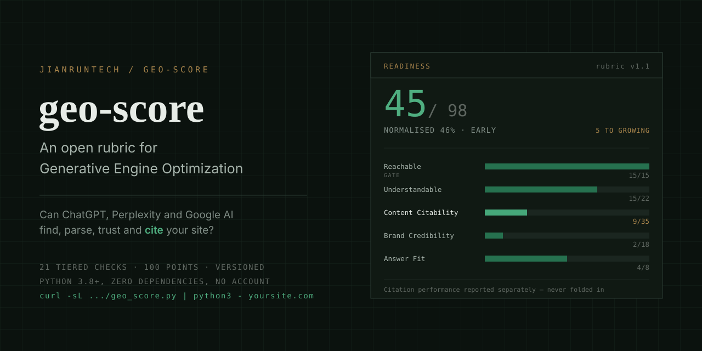

<p align="right"><a href="README.md">English</a> · <a href="README.zh-CN.md">简体中文</a></p>

<p align="center"></p>

# geo-score

**AI 能不能引用你的网站？免费打分，20 秒出结果。有没有引用？用你自己的 API Key 通过各家 API 实测。**

[](LICENSE)
[](rubric/v1.1.zh-CN.md)
[](cli/geo_score.py)
[](SKILL.md)
[](#mcp-服务)
[](CONTRIBUTING.md)
[](https://www.jianruntech.com/leaderboard/zh)

> **打分**（免费，不要 Key）→ **实测**一个问题（你的 API Key）→ 每周**追踪**一组问题（你的 API Key）。
> [一个工具，三级用法](#一个工具三级用法) · 引用结果从不加进分数。

```bash
curl -sL https://raw.githubusercontent.com/jianruntech/geo-score/v1.4.0/cli/geo_score.py \
  | python3 - stripe.com --brief
```

<p align="center"></p>
<p align="center"><sub>2026-09-09 用 geo-score 1.1.0 录制；2026-09-27 用 1.2.0 重跑为 72 分。</sub></p>

<sub>一行命令，约二十秒。每一项的分数，以及上一档要什么。</sub>


<details>
<summary>完整输出（每一项的分数、证据与下一档要求）</summary>

```
  AIV READINESS  https://stripe.com
──────────────────────────────────────────────────────────────────────────
  71 / 100   Solid
  12 points to Leading

  Reachable 11/15
   ◐ Crawlers allowed in robots.txt   ███████████░░░░░░░  3/5
   ✓ Reachable to retrieval agents    ██████████████████  5/5
   ◐ Main content server-rendered     ███████████░░░░░░░  3/5
  Understandable 15/22
   ◐ Sitemap discoverable and fresh   █████████░░░░░░░░░  2/4
   ✓ llms.txt present and structured  ██████████████████  5/5
   ✓ Organization + WebSite schema    ██████████████████  6/6
   ✗ BreadcrumbList on nested pages   ░░░░░░░░░░░░░░░░░░  0/3
   ◐ Page-type schema (Product, FAQ…) █████████░░░░░░░░░  2/4
  Content Citability 25/35
   ✓ Self-contained answer passages   ██████████████████  9/9
   ◐ Headings match how people ask    ████████░░░░░░░░░░  3/7
   ◐ Freshness signal present         █████████░░░░░░░░░  3/6
   ✓ Statistics carry a source        ██████████████████  7/7
   ◐ Named, verifiable authorship     █████████░░░░░░░░░  3/6
  Brand Credibility 8/10
   ⊘ Third-party listings             ··················   —
   ⊘ Independent mentions             ··················   —
   ✓ Knowledge-graph entity           ██████████████████  4/4
   ◐ sameAs links resolve             ████████████░░░░░░  2/3
   ◐ Video and multimodal presence    ████████████░░░░░░  2/3
  Answer Fit 2/4
   ◐ Content shaped for extraction    █████████░░░░░░░░░  2/4
   ⊘ Covers the questions people ask  ··················   —
   ⊘ Chinese engine readiness         ··················   —
  Biggest gaps
   +4   Headings match how people ask    about half do
   +3   Named, verifiable authorship     and the name links to a verifiable identity page
   +3   Freshness signal present         most pages do, and dateModified agrees with the visible date

  Scored 61 / 86 observable · 4 checks left the denominator · rubric v1.1
  Needs judgement: p3.listings, p3.mentions, p4.question-coverage, p4.cn-engines

  Full rubric and what each tier means:
  https://github.com/jianruntech/geo-score
```

</details>

Python 3.8+，只用标准库，不用装任何东西。它读取公开 URL，
按一套**公开、带版本号的评分口径**给分——不是黑箱。

**[看 317 个知名站点的公开榜单 →](https://www.jianruntech.com/leaderboard/zh)**  ·  其中四分之一，AI 爬虫读不到。

> **GEO 指的是生成式引擎优化**——让 ChatGPT、Perplexity、Google AI Overviews、
> Gemini、Copilot 引用你。与地理、地图无关。

---

## MCP 服务

`geo-score-mcp` 是一个本地 MCP 服务（stdio，只用 Python 标准库）。Agent 通过它能用到和命令行一样的三级：
免费给网站打分、拿一个问题去问各家 AI、每周追踪一组问题。

<!-- BEGIN MCP:install -->
<!-- 由 scripts/mcp_docs.py 按版本 1.4.0 生成；要改请改脚本，不要改这一段。 -->

[](https://cursor.com/en/install-mcp?name=geo-score&config=eyJjb21tYW5kIjoidXZ4IiwiYXJncyI6WyItLWZyb20iLCJodHRwczovL2dpdGh1Yi5jb20vamlhbnJ1bnRlY2gvZ2VvLXNjb3JlL3JlbGVhc2VzL2Rvd25sb2FkL3YxLjQuMC9nZW9fc2NvcmUtMS40LjAtcHkzLW5vbmUtYW55LndobCIsImdlby1zY29yZS1tY3AiXX0%3D)
[](https://insiders.vscode.dev/redirect?url=vscode%3Amcp%2Finstall%3F%257B%2522name%2522%253A%2522geo-score%2522%252C%2522command%2522%253A%2522uvx%2522%252C%2522args%2522%253A%255B%2522--from%2522%252C%2522https%253A%252F%252Fgithub.com%252Fjianruntech%252Fgeo-score%252Freleases%252Fdownload%252Fv1.4.0%252Fgeo_score-1.4.0-py3-none-any.whl%2522%252C%2522geo-score-mcp%2522%255D%257D)
[](https://insiders.vscode.dev/redirect?url=vscode-insiders%3Amcp%2Finstall%3F%257B%2522name%2522%253A%2522geo-score%2522%252C%2522command%2522%253A%2522uvx%2522%252C%2522args%2522%253A%255B%2522--from%2522%252C%2522https%253A%252F%252Fgithub.com%252Fjianruntech%252Fgeo-score%252Freleases%252Fdownload%252Fv1.4.0%252Fgeo_score-1.4.0-py3-none-any.whl%2522%252C%2522geo-score-mcp%2522%255D%257D)
[](https://lmstudio.ai/install-mcp?name=geo-score&config=eyJjb21tYW5kIjoidXZ4IiwiYXJncyI6WyItLWZyb20iLCJodHRwczovL2dpdGh1Yi5jb20vamlhbnJ1bnRlY2gvZ2VvLXNjb3JlL3JlbGVhc2VzL2Rvd25sb2FkL3YxLjQuMC9nZW9fc2NvcmUtMS40LjAtcHkzLW5vbmUtYW55LndobCIsImdlby1zY29yZS1tY3AiXX0%3D)

按钮和下面几行用 `uvx` 安装 geo-score **1.4.0** 的发布 wheel 包，只需要先装 [uv](https://docs.astral.sh/uv/)，不需要 git，也没有构建步骤。它们本身不带 Key，但如果启动服务的 shell 里 export 了服务商 Key（Claude Code 会把自己的环境变量传给服务），服务就能用它。要一个花不了钱的服务，在 `geo-score-mcp` 后面加 `--read-only`。

**Claude Code**

```bash
claude mcp add --scope user geo-score -- uvx --from https://github.com/jianruntech/geo-score/releases/download/v1.4.0/geo_score-1.4.0-py3-none-any.whl geo-score-mcp
```

**标准配置**（文件里不写 Key），适用于任何读取 `mcpServers` 配置文件的客户端：

```
{
  "mcpServers": {
    "geo-score": {
      "command": "uvx",
      "args": ["--from", "https://github.com/jianruntech/geo-score/releases/download/v1.4.0/geo_score-1.4.0-py3-none-any.whl", "geo-score-mcp"]
    }
  }
}
```

Claude Desktop 不读你 shell 里的 `PATH`：`command` 请填 `which uvx` 输出的完整路径。

从源码安装（需要 git）：`uvx --from git+https://github.com/jianruntech/geo-score@v1.4.0 geo-score-mcp`
<!-- END MCP:install -->

<!-- BEGIN MCP:tools -->
<!-- 由 scripts/mcp_docs.py 根据 MCPServer.tools() 生成；要改请改服务或脚本，不要改这张表。 -->

| 工具 | 级别 | 费用 | 写入 | 提示 | 参数 |
|---|:-:|---|---|---|---|
| `score_site` | 1 | 免费 | 否 | 只读、访问外部 | **`url`**、`urls`、`sample` |
| `ask` | 2 | 付费（你的 Key） | 否 | 非破坏性、访问外部 | **`question`**、`engines`、`brand`、`domains` |
| `run` | 3 | 付费（你的 Key）；`dry_run` 免费 | 运行文件，存到配置文件旁的 `.geo-score/watch/runs/` | 非破坏性、访问外部 | `dry_run`、`engines`、`limit`、`max_calls`、`budget_usd` |
| `list_runs` | 3 | 免费 | 否 | 只读、幂等 | — |
| `report` | 3 | 免费 | 否 | 只读、幂等 | `run`、`format` |
| `diff` | 3 | 免费 | 否 | 只读、幂等 | `from`、`to`、`format` |
| `status` | — | 免费 | 否 | 只读、幂等 | — |

资源：`geo-score://rubric/v1.1`。

提示词：`audit_site`（**`url`**）、`check_citations`（**`question`**、`brand`）、`weekly_watch`、`compare_runs`（`from`、`to`）、`explain_check`（**`check_id`**）。

加粗的参数必填。「提示」是工具的 MCP 标注（annotations）：客户端可以据此决定哪些调用要你确认；它们只是提示，不是保证。**只有 `ask` 和 `run` 会花钱**，而且只用你交给服务的服务商 Key。
<!-- END MCP:tools -->

**可以这样跟 Agent 说：**

| 提示 | 它调用的工具 |
|---|---|
| 给 https://acme.com 做 AI 搜索就绪度打分，列出最能提分的 3 项检查。 | `score_site`，参数 `url` |
| 把我追踪的问题集 dry-run 一遍，告诉我计划调用多少次、上限是多少。 | `run`，带 `dry_run: true`（第三级，需要配置文件） |
| 比较我最近两次 watch 运行：哪些引擎变了，有没有超出噪声的变化？ | `diff`（默认比较最近两次） |

**Key 与配置。** `score_site` 不要 Key。`ask` 和 `run` 从服务进程的环境变量里读服务商 Key
（`OPENAI_API_KEY`、`PERPLEXITY_API_KEY`、`GEMINI_API_KEY`、`ANTHROPIC_API_KEY`、`OPENROUTER_API_KEY`），
那不是你终端里的环境：桌面应用看不到你在 shell 里 export 的变量。第三级工具还需要 `geo-score-watch.json`，
请用 `-c /绝对路径/geo-score-watch.json` 传给服务，因为图形界面客户端不会在你的项目目录里启动它。
从 1.4.0 起，加上 `--read-only`，服务就花不了任何钱。

各客户端的配置（Claude Code、Claude Desktop、Codex、Cursor、VS Code、Gemini CLI、Devin Desktop、Zed）、
Claude Code 插件、超时、安全与排查：**[guide/mcp.zh-CN.md](guide/mcp.zh-CN.md)**。

## 一个工具，三级用法

| 级 | 回答什么 | 需要什么 | 命令 |
|---|---|---|---|
| **1 · 打分** | AI 引擎能不能抓到、读懂、信任并引用这个站？按公开量表打 0–100 分（就绪度） | 什么都不要：不要 Key，不用安装 | `geo_score.py stripe.com` |
| **2 · 实测** | 就你关心的那个问题，AI 现在引不引用它？ | OpenAI、Perplexity、Gemini、Anthropic、OpenRouter 任意一家的 API Key | `geo_score.py stripe.com --ask "best payments API for marketplaces"` |
| **3 · 追踪** | 你被引用的频率、输给了哪些竞品和来源、每周怎么变？ | 你的 API Key 和一组固定问题 | `geo_score.py watch run` |

第一级就是这 100 分。第二、三级测的是量表有意不计分的那部分结果（[两个分数，不要混在一起](rubric/v1.1.zh-CN.md#两个分数不要混在一起)）：
单独报告，从不加进 100 分。就绪度 90 分的站，照样可能每条回答都输给第三方报道更多的竞品；反过来也会发生，所以两样都要看。

第二、三级需要 `cli/geo_watch.py` 和 `cli/geo_score.py` 放在一起：克隆仓库，或者两个文件都下载。上面那行 `curl | python3` 只跑第一级。

## 这和 SEO 问的不是同一个问题

传统 SEO 问「我排第几」。回答引擎不排名——它检索段落、判断这个来源值不值得引用、
然后引用它。问题不同，失效方式也不同：一个站可以在 Google 排第 3 却从不被引用，
而一个没人链接的页面天天被引，因为它的段落干净。

决定这件事的东西，**大部分是机械的、改起来很便宜**——一行 `robots.txt`、
一个 JSON-LD 块、模板里的一个日期、把一段话改写成能独立成立的样子。
难的是知道自己缺了哪几项，以及每一项值多少分。

## 查什么

21 项阶梯式检查合计 100 分，另有 4 项加分检查、不进分母、最多 +6。
完整规范：**[rubric/v1.1.zh-CN.md](rubric/v1.1.zh-CN.md)** · [English](rubric/v1.1.md)

| 支柱 | 分值 | 在问什么 |
|---|:-:|---|
| **可被抓取** —— *门槛* | 15 | 检索爬虫拿不拿得到这一页？`robots.txt`、10 个 AI UA 的实测可达性、正文是否服务端渲染 |
| **可被理解** | 22 | 它能不能看懂这是什么页、你是哪家公司？`Organization` + `WebSite`、`llms.txt`、sitemap、面包屑、页型 schema |
| **内容可被引用** | **35** | 这里有没有值得引用的东西？自足答案段、标题是否匹配人的提问措辞、数据带出处、真实署名、时间信号 |
| **品牌可信** | 18 | 引擎凭什么信你？知识图谱实体、第三方收录、可解析的 `sameAs`、视频存在 |
| **问答适配** | 10 | 内容的形态便不便于被摘进一个答案？ |

内容可被引用权重最高是有意的：回答引擎检索的是**段落**，不是域名。
段落的结构比域名的权威更常起决定作用——这一点和传统 SEO 的直觉相反。

**每个计分项都是阶梯给分**——2 到 4 档，每一档写的是 8 个抽样页里的具体页数，
所以两个人给同一个站打分，在算术上不会有分歧。**其中三项是门槛**：
爬虫可达性、实测可达、服务端渲染，任一项得 0 分则总分封顶 40——
因为在爬虫拿不到内容之前，其余各项的改动都不会产生效果。

### 分数段

| 0–30 | 31–50 | 51–65 | 66–82 | 83–100 |
|:-:|:-:|:-:|:-:|:-:|
| 未起步 | 起步期 | 成长期 | 基础扎实 | 领先 |

档名描述的是**所处阶段，不是判决**。外部基准显示多数商业网站落在 30–55 之间，
所以四十几分是常态，不是警报。本仓库自己的基准榜单里，317 个站中 85% 达到起步期，10% 达到领先
（[档位线落在哪里](benchmark/README.md#where-the-band-cuts-fall)）。

## 317 个站点，公开打分

**其中四分之一，AI 爬虫读不到。** 83 个站有门槛项得 0 分——AI 检索爬虫拿不到内容，也就没有东西可引用。
23 个在 `robots.txt` 里点名屏蔽 AI 爬虫，那是编辑决策，如实记录即可——
amazon.com 只有 12 分正是这个原因。**另有 47 个站的正文只在 JavaScript 跑完之后才存在**，
内容是有的、浏览器看得见，爬虫拿到的是一个空壳；这一组几乎肯定不是有意的。
还有 13 个站，服务器拒绝爬虫 user-agent（探测来自审计方自己的地址，未经爬虫身份验证）。

中位数 **56**（95% 置信区间 52–58，见 [stats.py](benchmark/stats.py)），最低 11、最高 99。
其中 69 个站实际评分的页面不足 4 个，去掉它们后中位数是 62。

| 站点 | 分数 | 档 |
|---|:-:|---|
| pulumi.com | **99** | 领先 |
| resend.com | **99** | 领先 |
| lumalabs.ai | **94** | 领先 |
| kayak.com | **92** | 领先 |
| openrouter.ai | **90** | 领先 |
| … | | |
| amazon.com | 12 | 未起步 |
| mercadolibre.com | 12 | 未起步 |
| keepa.com | 11 | 未起步 |

**[完整榜单与分行业中位数 →](https://www.jianruntech.com/leaderboard/zh)** · [markdown](benchmark/README.md) · [原始数据](benchmark/results.json) · [CSV](benchmark/results.csv) · [每个站的完整报告](benchmark/raw/) · [自己重跑](benchmark/run.py)

另外两个值得点进去看的发现。五个中国行业的站比其余站**低 20 分**（95% 置信区间 16–28；中位 39 对 59；此前用 1.1.0
的几次取样测得的差距在 16 到 23 分之间）。改按站点面向的语言分组，50 个中文站比其余 267 个站低 20 分（95% 置信区间 13–25）；
相近行业一一对比，差距在 6 到 30 分之间；其中最多 68% 落在 CLI 靠启发式判断的检查项上（[拆解见此](benchmark/README.md)）。
逐项看，差得最多的是两项启发式判断：标题是否匹配提问意图、开头有没有能独立成立的答案段；
而在[人工审计对照](benchmark/VALIDITY.zh-CN.md)里唯一的中文站上，CLI 这两项也比人工判得低，所以这个差距里可能有一部分是工具对中文页面判得偏严。
另外，「具名、可核实的作者署名」和「一段能独立成立的开头」在超过一半的站上都排进了最大的三个缺口。

**中文说明页**：[这套量表测什么、三项门槛为什么会封顶、测出问题之后怎么办](https://www.jianruntech.com/geo-score)——由维护者见润科技提供，量表本身与它无关，MIT 开源、可自行复算。

每个数字都能用页首那条命令复现（榜单是 2026-09-27 用 1.3.0 跑的）——而且我们把「能复现到什么程度」也测了，
不过用的是旧版本：2026-09-09 用 1.1.2 修正波动之前的 1.1.x 版本把整个榜单跑两遍、逐站比对：**96% 的站落在 ±5 以内，
45% 完全一致**（ICC 0.97，SEM 3.1）。当前版本还没有重测，[benchmark/retest.py](benchmark/retest.py) 是提交进仓库、可以重跑的重测脚本。
所以单个站的分数请按 ±5 读，不要当成精确值；中位数是稳的。
不稳的是门槛检查——两次之间有五个站翻转，因为它们的 bot 防护对爬虫的答复变了。
精度区间、对照实验和逐站配对都在
[benchmark/REPRODUCIBILITY.md](benchmark/REPRODUCIBILITY.md)。

对其中五个参照站，我们另外发布了**人工逐项审计**，
覆盖全部 21 项检查、每一项都附证据：[examples/audits/v1.1/](examples/audits/v1.1/)。

## 几种跑法

**CLI** —— 第一级只要一个文件、无依赖、20 秒；第二、三级再加上同一版本的 `cli/geo_watch.py`。

```bash
python3 cli/geo_score.py example.com            # 人读
python3 cli/geo_score.py example.com --explain  # 带每一项背后的证据
python3 cli/geo_score.py example.com --json     # 符合 schema/report.v2.json
python3 cli/geo_score.py example.com --compare competitor.com   # 和竞品并排比
python3 cli/geo_score.py example.com --badge aiv-badge.svg      # 生成可嵌入的 SVG 徽章
python3 cli/geo_score.py example.com --share                    # 一行可以贴出去的结论
```

**GitHub Action**（第一级）—— 每次 push 都打分，退步就让构建失败。第三级按周定时跑见 [examples/ci/watch-weekly.yml](examples/ci/watch-weekly.yml)。

```yaml
- uses: jianruntech/geo-score@v1
  with:
    url: https://example.com
    fail-under: 40
```

**Claude Code 技能** —— CLI 只能测静态抓取看得见的东西。
有四项需要站外检索或人的判断，技能把这些也做了。

```bash
git clone https://github.com/jianruntech/geo-score ~/.claude/skills/geo-score
# 然后：/geo-score audit https://example.com
```

CLI 会把那四项**退出分母**而不是猜。拿公开的 5 份人工审计在相同页面上重评，86 对检查项里有 79% 与审计者档位一致
（按规则读取的项 95%，靠启发式近似判断的项 64%）。只看两边都打了分的检查项，CLI 平均低 0.4 分
（逐站从低 6 分到高 9 分，平均绝对差 5.2 分）；按完整的归一化分算平均低 3.6 分，范围从低 10 分到高 6 分，
因为人工审计还给 `p3.listings`、`p3.mentions`、`p4.question-coverage` 打了分，CLI 不打这三项。
样本只有 5 个站，而且都是当初用来校准的站，每一处分歧见 [VALIDITY.zh-CN.md](benchmark/VALIDITY.zh-CN.md)。

**MCP 服务**（三级都有）—— `geo-score-mcp`，或者在克隆的仓库里 `python3 cli/geo_score.py mcp`，给 Claude Code、Cursor 等 Agent 用，见 [MCP 服务](#mcp-服务)。

## 第二、三级 · AI 到底有没有引用你

`--ask` 和 `watch` 用你自己的 Key，通过各家带联网搜索的 API，把买家会问的问题拿去问 ChatGPT、Perplexity、
Gemini 和 Claude，记下每条回答引用了谁：是你、是竞品，还是 AI 更愿意引用的第三方页面（论坛、测评站）。
Key 只从环境变量读，geo-score 不会把它写到任何地方。

```bash
git clone https://github.com/jianruntech/geo-score && cd geo-score/cli
export OPENAI_API_KEY=… PERPLEXITY_API_KEY=…         # 有几个 Key 就测几个引擎
python3 geo_score.py acme.com --ask "best invoicing app for freelancers"   # 第二级
python3 geo_score.py watch init --brand Acme --domain acme.com --competitor "Rival=rival.com"
# 把买家会问 AI 的问题写进 queries.csv，然后：
python3 geo_score.py watch run --dry-run            # 只看计划和上限，不调用、不花钱
python3 geo_score.py watch run                      # 第三级：每个问题问每个引擎，并保存
python3 geo_score.py watch diff                     # 和上一次比，带显著性检验
```

<details>
<summary>watch 跑一次的输出（示意：虚构的品牌和预设的回答，不是真实测量）</summary>

```
geo-score watch · Lumo · run 20260926T083000Z · api channel

6 questions × 2 engines × 2 = 24 planned · 23 answered · 1 failed · 0 skipped

Cited in 38% of answers to questions that do not name Lumo (6 of 16, 4 questions, 95% CI 12–62%) · mentioned in 38%
Questions that name Lumo (2, kept out of the headline): cited in 100% (7 of 7, 95% CI 65–100%) · mentioned in 100%
Your site was cited somewhere for 5 of 6 questions.

By engine
  engine          model             cited         95% CI   mentioned  avg rank
  chatgpt-api     gpt-6-luna        9/12 75%      42–100%  75%        1.0
  perplexity-api  sonar             4/11 36%      8–75%    36%        2.0       1 failed
  gemini-api      gemini-3.8-flash  not measured                                no_key: set GEMINI_API_KEY or GOOGLE_API_KEY

These rows, and the tables below, count every question, the 2 that name Lumo included.

Share of voice
              cited  95% CI  mentioned
  Lumo (you)  57%    26–86%  57%
  Pixa        52%    33–71%  100%

Sources the engines cite most (not yours)
  domain        answers  share  owner
  pixa.example  12       52%    Pixa
  reddit.com    11       48%

Questions where a competitor is cited and you are not (1)
  id   question                    cited instead
  q03  cheapest text to video app  Pixa

By question type
  type         cited     95% CI   mentioned
  alternative  2/4 50%   15–85%   50%
  list         4/8 50%   22–78%   50%
  pricing      3/7 43%   0–100%   43%
  vs           4/4 100%  51–100%  100%

What the engines searched for (from 12 answers that show it)
  times  search
  2      best free ai video generator
  2      ai video tool with no watermark
  2      cheapest text to video app
  2      lumo vs pixa
  2      pixa alternatives
  2      鹿末视频免费吗

Ledger
24 questions asked · 23 API requests · 14,620 in / 4,860 out tokens · 23 searches · $0.07 + 12 answers with no price (add prices to geo-score-watch.json)
Caps: at most 100 questions.

Read this before quoting the numbers
- API channel. Answers come from each provider's search-enabled API, which is not the consumer app. Compare runs with runs; never pool them with answers sampled by hand in the apps.
- The same question gets different answers from one ask to the next, and answers to one question move together. Rates carry a 95% interval: Wilson when each question was answered once, a bootstrap over questions when a question has several answers. diff pairs the questions both runs answered and calls a change a change only when an exact paired test (McNemar, or a sign-flip test when a question has several answers), Holm-corrected across engines, says so (p < 0.05).
- A question that names the brand invites an answer that cites it. Those questions are kept out of the headline rate and reported on a line of their own.
- Engines without a key, calls that failed and calls skipped by a cap count as not measured, never as zero.
- This measures citations. It does not predict traffic, rankings or revenue.
```
</details>

**第二级**每个问题在每个引擎上问一次，结果印在就绪度报告下面（加 `--json` 时写进报告的 `citation` 字段）。
一次问答只是个例：用来看 AI 今天怎么说，不是用来算比率的。

**第三级**固定一组问题，每条回答都存进 `.geo-score/watch/runs/`（[schema](schema/watch.v1.json)），报告里有：

| | 含义 |
|---|---|
| **被引用（cited）** | 回答链接到你的网址：`domains` 里的域名（含子域名），或 `url_prefixes` 里的前缀，比如你的亚马逊店铺页、GitHub 组织页 |
| **位次（rank）** | 在这条回答引用的不同域名里，你排第几。1 = 第一个来源 |
| **被提及（mentioned）** | 回答正文里出现了你的名字、`aliases` 里的别名或域名。中文、日文、韩文名按包含匹配，其他名字（包括带重音的拉丁字母）按整词匹配 |
| **声量份额** | 同一批回答里，每个竞品的被引用率和被提及率 |
| **来源** | 被引用最多的第三方域名，也就是 AI 在你这个品类里信得过的那些页面 |
| **缺口** | 竞品被引用、你一次都没被引用的问题 |
| **实际搜索词** | 引擎回答前真正搜了什么（OpenAI、Gemini、Claude 的 API 会给出）。这就是 query fan-out，是实际记下来的，不是猜的 |
| **账本** | 问了几个问题、发了几次请求、用了多少 token 和搜索、花了多少钱。每次运行一本 |

**它不告诉你什么。**

- **这不是 ChatGPT App 里的回答。** 数据来自各家 API（开了联网搜索）。App 用的模型、系统提示
  和个性化都不一样。API 渠道只和 API 渠道比，别和人工在 App 里采的样本混着算。
- **一条回答只是个例。** 同一个问题问两次，引用的来源可能不同。所有比率都带 95% 区间（同一问题有多条回答时，
  这些回答会一起变动，区间按问题做自助法重抽样）；`diff` 只比较两次都回答了的问题，用精确配对检验并对各引擎做
  Holm 校正，p < 0.05 才说「有变化」，共同问题太少（少于 6 个，或相对比较的引擎数太少）时直接说「问题太少，无法判断」。20 个问题 × 1 个引擎，
  区间就是很宽，数据只能说到这个份上。方法见 [guide/watch-methodology.zh-CN.md](guide/watch-methodology.zh-CN.md)。
- **提到你品牌的问题单独统计。** 「acme vs rival」「acme 值不值」这类问题会把品牌名带进引擎的搜索，几乎每次都会被引用。
  `watch` 在运行时标出这类问题，把它们排除在标题引用率之外，单列一行并给出各自的样本数。`queries.csv` 可选的
  `branded` 列可以手动修正标记。
- **没测不等于 0。** 没有 Key 的引擎、失败的调用、被上限跳过的调用，都记为「未测」，
  不会拉低你的比率。
- **被引用不等于流量。** 这里不预测访问量、排名，也不预测收入。

**引擎。** 在配置里写死要测的模型，每周保持不变；换了模型的那次，`diff` 会标出来。OpenRouter 一个 Key 能调几百个模型。

| 默认引擎 id | 服务商 | Key | 默认模型 | 怎样算被引用 | 能看到搜索词 | 自报费用 |
|---|---|---|---|---|---|---|
| `chatgpt-api` | OpenAI Responses API + `web_search` | `OPENAI_API_KEY` | `gpt-6-luna` | `url_citation` 标注 | 能 | 否，需配价格 |
| `perplexity-api` | Perplexity Sonar | `PERPLEXITY_API_KEY` | `sonar` | 正文用到的编号来源 | 否 | 是 |
| `gemini-api` | Gemini Interactions API + `google_search` | `GEMINI_API_KEY` 或 `GOOGLE_API_KEY` | `gemini-3.8-flash` | `url_citation` 标注 | 能 | 否，需配价格 |
| `claude-api` | Anthropic Messages + `web_search` 工具 | `ANTHROPIC_API_KEY` | `claude-sonnet-5` | 正文上的 citations | 能 | 否，需配价格 |
| 自定 id | OpenRouter + `web` 插件 | `OPENROUTER_API_KEY` | `openai/gpt-6-luna` | `url_citation` 标注 | 否 | 是 |

**上限与费用。** `max_calls` 是单次运行问题数的硬上限，计划超了就不开始；`budget_usd` 每次调用前核一次：
已花的钱加上这个引擎目前最贵的一次调用，所以最多超出每个引擎一次调用的费用。设了 `budget_usd` 时，算不出费用的引擎不跑，除非加 `--allow-unpriced`。每次运行都有账本：
请求数、token、搜索次数、花费。配置、价格和全部命令见 [cli/README.md](cli/README.md#watch)。

**在 Agent 里用。** 第二、三级同样是 MCP 工具，Agent 只能把上限调得更紧，不能放宽，见 [MCP 服务](#mcp-服务)。

**每周跑一次。** 引用率变得慢、噪声也大：固定星期几、固定问题、固定模型，看 `diff`，别盯单次结果。
[examples/ci/watch-weekly.yml](examples/ci/watch-weekly.yml) 按时自动跑，Key 放在仓库 Secrets，每次运行都提交回仓库，历史都在 git 里。运行文件里有你的问题和 AI 的完整回答，问题集要保密就用私有仓库。

**自己跑免费；想省事，可以交给我们。** 这里的一切都是 MIT，工具本身没有付费版。API 费用你直接付给
各家服务商，每次花了多少账本里都有。需要人来做的部分，[见润科技](https://www.jianruntech.com/)作为服务来做：

| | 自己跑（免费） | 交给见润（GEO 落地系统） |
|---|---|---|
| 渠道 | 带搜索的 API | API，加上每周在 App 里人工采样 |
| 引擎 | OpenAI、Perplexity、Gemini、Anthropic，以及 OpenRouter 上的模型 | ChatGPT（联网）、Perplexity、Gemini、Google AI Overviews、Copilot；做国内市场再加国内引擎 |
| 报告 | 文本、Markdown、CSV、JSON | 周报和 AIV 看板：引用率趋势、分引擎结果、AI 说错你的事实、就绪度历史 |
| 引用掉了怎么办 | 不在工具范围内 | 我们来改 |
| 价格 | 你的 API 账单 | GEO 落地系统，¥38,888 起 / 3 个月，含 AIV 看板。[看价格](https://www.jianruntech.com/#pricing) |

## 为什么发布口径，而不只发工具

一个你没法复核的分数，就是别人编出来的数字。所以规范本身才是产品，工具只是它的实现：

- **带版本号。** 每个分数都要报口径版本。`71（v1.1）`是一个主张，`71` 不是。
- **阶梯给分，写明页数。** 每一档写的是 8 页里的具体页数，不是「多数」。
- **必须有证据。** 每一项都要留一个别人能复现的观察。
- **对着公开基准标定过**，并[公开了标定记录](rubric/calibration-v1.1.zh-CN.md)——包括档位线所对照的四份外部数据，以及真实审计暴露、v1.1 逐条定掉的[八处口径歧义](rubric/open-questions.zh-CN.md)。
- **机器可读。** [`rubric/v1.1.json`](rubric/v1.1.json) 带永久 check id，[`schema/report.v2.json`](schema/report.v2.json) 让不同实现跑出来的结果可以互相比较。

用你自己的技术栈实现它、对某个权重有异议，[开一个口径提案](.github/ISSUE_TEMPLATE/rubric_proposal.yml)。这是我们最希望收到的贡献。

## 边界 · 这个仓库不做什么

这是大多数工具会略过的部分，所以直说。

**geo-score 只测量，不修复。**

| 不包含 | 为什么 |
|---|---|
| 修复模板 —— `robots.txt`、JSON-LD 代码块、`llms.txt` 样板 | 修复才是真正需要工作量和判断的地方，那是另一个不开源的项目 |
| 内容改写 —— 怎么把一段话写成会被引用的样子 | 同上 |
| 分平台打法 —— 对 Perplexity 和对 Gemini 该分别怎么做 | 同上 |
| 改造路线图 | 同上 |

**其他要说清的限制：**

- **它测的是输入侧的就绪度，不是结果。** 分高只说明引擎**能**引用你，
  至于**会不会**引用，取决于竞争和提问意图，这些外部审计观察不到。
  引用表现单独测、单独报，**不进这 100 分**——见
  [两个分数，不要混在一起](rubric/v1.1.zh-CN.md#两个分数不要混在一起)。用上面的第二、三级来测它。
- **品牌可信与具名作者这一项需要人的判断。**「这个作者是不是真实可查的人」
  「这条提及是不是独立的」没法完全自动化。这 24 分左右应当视为辅助判定。
- **阶梯降低分歧，但消不掉分歧。** 每一档都写成 8 个抽样页里的具体页数，
  所以两个审计者在算术上不会分歧；但「这一段算不算自足答案」仍然是判断。
  [已定掉的歧义](rubric/open-questions.md)是我们发现的那些，一定还有别的。
- **重客户端渲染的站会打低分，有时不公平。** 如果内容要 hydration 之后才出现，
  大部分检查读到的是 hydration 之前的 HTML——那也大致就是爬虫看到的，
  所以低分通常是对的，但值得人工复核一遍。
- **引擎行为会变。** 口径带版本号正是为此。旧版本口径算出来的分与当前版本不可比。

## 权重的研究依据

权重是有主张的，但不是拍脑袋。影响最大的两项：

- **[Aggarwal et al., *GEO: Generative Engine Optimization*, KDD 2024](https://arxiv.org/abs/2311.09735)**
  —— 引用来源、加入统计数字、引述专家可以把可见度提升**最多 40%**
  （度量口径是 Position-Adjusted Word Count，不是引用次数）。
  值得注意的是，论文发现**「权威语气」没有显著提升**——
  这正是本口径给结构和出处打分、而不给语气打分的原因。
- **[llms.txt 提案，Answer.AI](https://llmstxt.org/)** —— 可被理解支柱里 `p1.llms-txt` 检查的就是它。

每一项检查都注明了权重建立在什么依据上——公开研究、厂商自己的文档、我们自己的实地观察，还是一项没有引擎确认使用过的约定——
并附来源与最后核实日期：[rubric/evidence-v1.1.zh-CN.md](rubric/evidence-v1.1.zh-CN.md)。证据单薄的几项
（`p2.answer-passages`、`p2.question-intent`、`p1.llms-txt`）表里直接写明，它们是 v1.2 重新定权的首批候选。
如果你有证据表明某个权重不对，
[提一个口径提案](.github/ISSUE_TEMPLATE/rubric_proposal.yml)——这是我们最希望收到的贡献。

## 相关项目

刻意说清这个仓库**不是**什么，方便你选对工具：

| 项目 | 做什么 | 关系 |
|---|---|---|
| [llms-txt](https://github.com/AnswerDotAI/llms-txt) | `llms.txt` 规范本体 | geo-score 检查是否符合它 |
| [yao-geo-skills](https://github.com/yaojingang/yao-geo-skills) | 21 个分类 GEO 技能，偏执行 | 互补——它做生产，这里做测量 |
| [GEOFlow](https://github.com/yaojingang/GEOFlow) | 企业官网 GEO 运营系统 | 范围大得多；AGPL 协议 |

如果你要的是修复而不只是一个分数，上面这些项目覆盖了本仓库刻意排除的那部分。

## 稳定性、隐私与安装

- **安装：** 第一级什么都不用装（上面那行 `curl`，锁定到某个发布版本）；想要一个包含三级的 `geo-score` 命令，安装发布的 wheel 包：
  `pipx install https://github.com/jianruntech/geo-score/releases/download/v1.4.0/geo_score-1.4.0-py3-none-any.whl`。
  不安装直接运行：
  `pipx run --spec https://github.com/jianruntech/geo-score/releases/download/v1.4.0/geo_score-1.4.0-py3-none-any.whl geo-score example.com`
  或 `uvx --from https://github.com/jianruntech/geo-score/releases/download/v1.4.0/geo_score-1.4.0-py3-none-any.whl geo-score example.com`。
  这几种方式都不需要 git，也没有构建步骤。
  从源码安装（需要 git）：`pipx install git+https://github.com/jianruntech/geo-score@v1.4.0`。每种方式都只用 Python 标准库。
  发布的下载文件附带 `SHA256SUMS`（[如何校验](SECURITY.md#verifying-a-download)）。
- **稳定性：** 量表和工具分开编版本号；报告 schema、检查项 id、命令行参数、退出码、Action 输入输出、
  MCP 工具都是公开契约，哪个版本允许改什么，见 [STABILITY.md](STABILITY.md)。
- **不收集任何遥测数据。** geo-score 不向我们或任何人发送数据。第一级只访问你指定的网站（包括它的跳转）、它的标记和 robots.txt 指向的地址
  （`sameAs` 主页链接、logo、声明的 sitemap，检查是否有效），以及 Wikidata 和维基百科的搜索接口；第二、三级只调用你配了 Key 的 AI 服务商。
- **安全：** 报告里引用的网站原文一律标注为数据，MCP 服务的 `score_site` 只连接公网地址，Key 从不写进任何文件。
  威胁模型与漏洞报告方式见 [SECURITY.md](SECURITY.md)。

**为什么我的分数变了 4 分？** 每次运行最多抽 8 个页面，每次抽到的不完全一样，用 1.1.x 版本实测的波动是 ±5
（[REPRODUCIBILITY.md](benchmark/REPRODUCIBILITY.md)）。要做改动前后的对比，用 `--urls-from last.json` 重评同一批页面。
**为什么某项显示 `—`？** 它没有被测到，所以移出了分母，而不是记 0 分。更多问题见[排查指南](guide/troubleshooting.zh-CN.md)。

### 能不能拿来商用

| 用法 | 可以吗 | 要做什么 |
|---|---|---|
| 个人学习、测自己的站 | 可以 | 无 |
| 公司内部用 | 可以 | 无 |
| 代运营 / 咨询公司给客户做诊断并收费 | 可以 | 保留 LICENSE 里的版权声明；报告里写明量表版本（如 v1.1），客户才能复核 |
| 集成进自己的 SaaS 或产品 | 可以 | 保留版权声明；分数请注明「按 AIV 量表 v1.1 计算」，不要改了权重还叫 AIV 分 |
| 改代码后再发布 | 可以 | MIT 协议，保留版权声明即可 |

MIT 协议不需要找我们授权，也没有单独的商业许可证。

## 谁在维护

由深圳 **[见润科技](https://www.jianruntech.com)** 建立并维护——
我们为跨境出海企业做 GEO 与 AI 落地。这套口径来自客户项目和优化我们自己产品的过程；
把它公开，是希望 AI 可见度能有一个一致的衡量方式，**包括被那些永远不会成为我们客户的人使用**。

本仓库的商业使用不受限制（MIT），包括用在付费咨询项目里。
不需要获得我们许可，也没有另外的商业授权。

## 参与贡献

最有价值的贡献是**关于权重的证据**。见 [CONTRIBUTING.md](CONTRIBUTING.md)。
分数不对、对榜单某一行有异议、工具用不了，各自用哪张 issue 表单，见 [SUPPORT.md](SUPPORT.md)。

## 引用

在研究或报告中引用本口径，见 [CITATION.cff](CITATION.cff)。

## 开源协议

[MIT](LICENSE)
